# FreeFlow user testing: handoff

As of 19 Nov 2026. An editable copy of this handoff also lives as a Claude Doc; the Status column there is the one to update.

## Summary

Five testers used freeflow.website on 18–19 Nov 2026, once signed out and once signed in. The core loop works and is fast. The problems sit in four places: navigation, money figures people can trust, brief extraction, and first impressions.

**Fix these five first**

1. Deploy the newer code (H1). The live site still shows donations, the Per-project pricing tab and a curse word in an interview quote.
2. Get the confirmation email out of Spam (H2). Every tester's sign-up looked like a dead end.
3. Stop the floating "+" button covering content, and give the menu text labels (H3).
4. Make "Mark paid" reversible, and let people set the date they were paid (H4).
5. Make brief extraction carry a fixed budget into the new project (H5).

**Context**

- The live site runs older code than the week6 branch (7 commits are not on main). Every finding describes the live site as it was tested.
- The five test accounts and their projects are still on production. They raise the public "People using FreeFlow" count.
- The testers were AI personas driving a real browser, not people. Treat findings as strong leads to confirm, not measured behaviour.

### All issues

IDs match the headings in the three Fix sections below. Set Status as you work through them.

| ID | Problem | Impact | Seen by | Status |
| --- | --- | --- | --- | --- |
| H1 | Live site shows donations, Per-project pricing and a curse word | High | All 5 | Not started |
| H2 | Confirmation email lands in Spam | High | All 5 | Not started |
| H3 | Floating "+" covers content and is the only, icon-only menu | High | All 5 | Not started |
| H4 | "Mark paid" can't be undone or dated | High | All 5 | Not started |
| H5 | Brief extraction drops the fixed budget, currency and client type | High | All 5 | Not started |
| H6 | Brief extraction result is lost on reload | High | William, Clarisa, Adam, Tony | Not started |
| H7 | New project errors show one at a time, off-screen | High | All 5 | Not started |
| H8 | Currency switch is invisible and relabels amounts | High | Clarisa, Adam, Anton, Tony | Not started |
| H9 | Pricing page never says what FreeFlow costs | High | William, Clarisa, Anton, Tony | Not started |
| H10 | Signed-out dashboard doesn't explain the product | High | William, Clarisa, Anton | Not started |
| M1 | Dashboard money figures contradict each other | Medium | Clarisa, Anton | Not started |
| M2 | Help desk is hard to reach and sometimes answers the wrong question | Medium | All 5 | Not started |
| M3 | "Sort it for me" can't be clicked with a mouse or finger | Medium | William, Clarisa, Adam | Not started |
| M4 | Public pages read like a course project | Medium | Clarisa, Anton | Not started |
| M5 | No privacy, terms or contact pages; plain white 404 | Medium | Adam, Anton | Not started |
| M6 | FreeFlow can't create or send invoices | Medium | William, Anton | Not started |
| M7 | Mobile: small tap targets, zooming inputs, squashed search | Medium | Tony | Not started |
| M8 | Unsaved work is lost without warning | Medium | William, Clarisa, Adam, Tony | Not started |
| M9 | Jargon and internal names shown to users | Medium | William, Clarisa, Anton | Not started |
| M10 | One feature goes by many names | Medium | William, Clarisa, Anton | Not started |
| M11 | A long project name breaks the dashboard layout | Medium | Adam | Not started |
| M12 | Zero-value projects are accepted; old dates show no year | Medium | Adam | Not started |
| M13 | Keyboard focus gets lost | Medium | Adam, Tony | Not started |
| M14 | Sign-up and login show raw server errors | Medium | Adam | Not started |
| M15 | A malformed project ID returns a server error (500) | Medium | Adam | Not started |
| L1 | Email address breaks mid-word on the confirm page | Low | All 5 | Not started |
| L2 | Home page notes overlap | Low | William, Clarisa, Anton, Tony | Not started |
| L3 | Two logos, five sign-up labels, "Welcome back" for new users | Low | William, Anton | Not started |
| L4 | Small copy and number mistakes on /pricing and /product | Low | Adam, Anton, Tony | Not started |
| L5 | Sign-out and sign-in land on the wrong page | Low | William, Clarisa, Adam | Not started |
| L6 | No bulk actions or keyboard shortcuts | Low | Adam | Not started |
| L7 | Payment-terms setting can't be emptied | Low | Adam | Not started |
| L8 | Pricing sliders jump on touch | Low | Tony | Not started |
| L9 | Resend link trusts the address in the URL | Low | Adam, Anton | Not started |
| L10 | Demo page keeps loading and shows "Try free" when signed in | Low | William, Clarisa | Not started |

## How the test was run

Each tester ran in its own isolated Chromium browser through Playwright, so logins and cookies never mixed. Every session logged console errors, failed requests, HTTP errors and responses slower than 3 seconds.

| Tester | Persona | Screen | What they focused on |
| --- | --- | --- | --- |
| William | Impatient first-timer | Desktop, 1440×900 | Fewest clicks to the main task; skips instructions |
| Clarisa | Non-technical casual user | Desktop, 1440×900 | Jargon, unclear icons, missing feedback |
| Adam | Power user | Desktop, 1440×900 | Edge cases, keyboard use, speed, deep features |
| Anton | Skeptical critic | Desktop, 1440×900 | Copy, polish, trust signals, pricing clarity |
| Tony | Mobile user | iPhone 13, 390×844, touch | Layout, tap targets, forms on a small screen |

**Two sessions each**

1. Signed out: wandered the public site with no script, then signed up with a +test Gmail address.
2. Signed in: the five accounts were confirmed by hand in Supabase, because the emails had gone to Spam. Each tester then logged in and used the product.

**Limits**

- Each tester could make at most 3 calls per AI feature. In total: 13 brief extractions and 8 help desk messages.
- No payments, account deletions or ticket submissions.
- Testers judged the site only as users. None of them read the code.

## The testers

Each tester's path, where it stalled, and what that persona would change. The problems themselves are written up once, in the Fix sections.

### William, impatient first-timer

**Journey.** /dashboard opened on public stats, so William clicked the big "+" and then hunted through unlabelled icons. Sign-up was 1 click from the home page and 2 from /dashboard. After signing in, William added a project, marked it paid, turned a brief into a project, then asked the help desk how to invoice a client.

**Stuck at.** The confirmation email (H2). A New project error that appeared off-screen (H7). Brief to project took about 6 actions despite the promise "without retyping a thing" (H5). The help desk answer that FreeFlow can't send invoices (M6), the point where William would quit.

**Liked.** Two-field sign-up with a clear "Creating…" state. Landing on the dashboard with the New project form already open. Fast pages.

**Would change.** Open /dashboard on a sign-up pitch. Cut New project to Name, Client and Amount. Make "Add to dashboard" the one action on /core. Add an Undo toast to Mark paid.

### Clarisa, non-technical casual user

**Journey.** Couldn't tell what FreeFlow does from the first screen. Read "+" as "create", not "menu". Signed up without trouble, then added two projects, marked one paid, tried brief extraction, asked the help desk two questions, switched currency to MXN and exported a CSV.

**Stuck at.** Trying to undo Mark paid: Edit has no paid/unpaid option, and the help desk first explained how to mark a project paid (H4, M2). A project shown as "9d late" while the forecast expects its money in December (M1). Not knowing whether to press "Save to database" or "Create project" (M10).

**Liked.** The calm confirm-email page. The demo's worry notes ("did they pay??"). Delete asking first, with a friendly "Keep it". One-click CSV export.

**Would change.** One plain sentence about the product at the top. A labelled menu. A single plain name for brief extraction, such as "Add a job from an email". Plain words instead of IVA, CFDI, ARR and the rest.

### Adam, power user

**Journey.** Tested every form with odd input: emoji, HTML, script tags, huge and negative numbers, double-clicks, Back and refresh mid-flow, malformed URLs and IDs. Walked the whole dashboard by keyboard. Checked that settings follow the account to a new browser.

**Stuck at.** Looking for bulk actions or shortcuts; there are none (L6). "Sort it for me" with a mouse (M3). Getting the help desk to answer the actual question (M2). Brief extraction losing the fixed budget (H5).

**Liked.** Speed everywhere (public pages under 0.75s). Every double-click sent exactly one request. Hostile input saved and shown safely as text. CSV export blocks formula tricks. Search and filters live in the URL.

**Would change.** Row checkboxes with bulk actions. A ⌘K palette plus "n" and "/" shortcuts. Every validation error shown at once. Drafts kept across reloads. A 404 instead of a 500 for bad IDs.

### Anton, skeptical critic

**Journey.** Read every public page closely and checked footer links for 404s. Signed up, then built three projects, including one with Mexican tax withholding. Tested brief extraction in English and Spanish and asked the help desk about pricing, privacy and undo.

**Stuck at.** Finding a plain price (H9). Finding privacy or terms pages; they don't exist (M5). Reconciling one invoice shown as $1,200, $1,392 and $1,144 in different places (M1).

**Liked.** The distinctive home page story. Unusual honesty: "27 of 32 capabilities are built. 5 are not." Withholding arithmetic that checks out. A clean CSV with every tax column.

**Would change.** Split the customer site from the build log. Publish Privacy and Terms. Tell one pricing story everywhere. Use one logo and one sign-up label.

### Tony, mobile user

**Journey.** Ran every page at 390×844 with touch. Signed up, created a fixed-fee project and an hourly overdue one, edited, marked paid, used brief extraction, asked the help desk one question, and switched currency.

**Stuck at.** An empty "Add project" submit that looked like nothing happened (H7). A search box too narrow to read (M7). A brief extraction result that vanished on reload and cost an extra AI call (H6). Recording an MXN fee in a USD account (H8).

**Liked.** No sideways scrolling on any page. Proper labels and number keypads on forms. The overdue banner at the top of the dashboard. Edit opening inline.

**Would change.** Bottom padding so the "+" covers nothing. 16px input text so iOS stops zooming. Tap targets of at least 44×44. A "+ New project" button near the top of the dashboard.

## Fix first (high impact)

These ten either block a first-time user, make money figures untrustworthy, or were hit by four or five testers.

### H1. Live site shows donations, Per-project pricing and a curse word

**Seen by:** all 5. **Where:** /support, /pricing, the Dock, the dashboard footer.

**What happens.** /support loads (HTTP 200) with Stripe buttons "Give $5 / $15 / $50". The Dock has a heart icon linking to it, and the signed-in dashboard footer says "Chip in for hosting". /pricing still has a "Per-project" tab and an "optional donation" link. /pricing?tab=tiers and ?tab=project quote an interviewee: "I sell 1 time install shit so not a retainer model…".

**Expected.** All of these are switched off or reworded in the week6 branch, which isn't deployed.

**Fix.** Merge week6 into main, deploy, then re-check /support, /pricing?tab=tiers and the Dock.

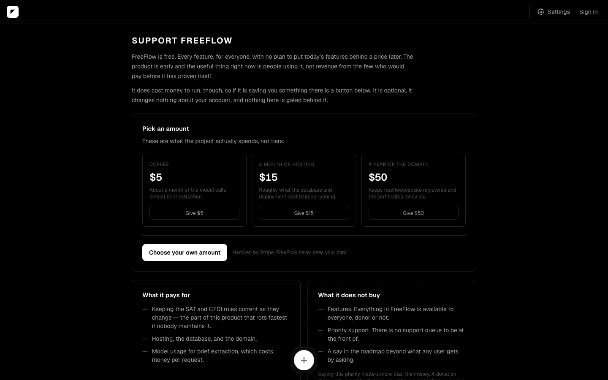

*/support on the live site: Stripe donation buttons that week6 switches off. (William, signed out)*

### H2. Confirmation email lands in Spam

**Seen by:** all 5. **Where:** sign-up, then /verify-email.

**What happens.** Sign-up succeeds and the page says "We sent a link to … Check spam if it has not arrived". None of the five emails reached the inbox; all were in Gmail Spam. To a new user, sign-up looks like a dead end. The form's promise "Takes ten seconds" makes it worse.

**Expected.** The email arrives in the inbox within a minute.

**Fix.**

- In Brevo, confirm SPF, DKIM and DMARC are valid for freeflow.website.
- Send from a named address (for example hello@freeflow.website) and rewrite the default Supabase template so it reads like FreeFlow.
- Score the email at mail-tester.com.
- On /verify-email, make "Check your Spam folder" the headline and add an "Open Gmail" button.

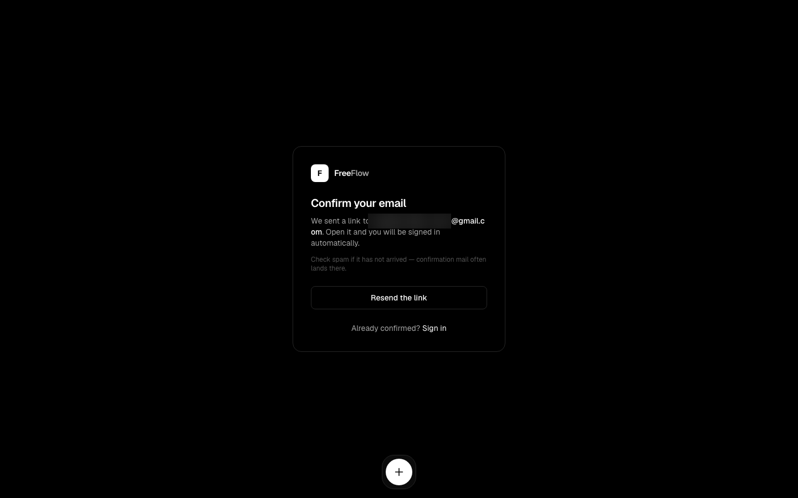

*/verify-email after sign-up. The spam hint is small grey text under the main message. The address also breaks as "gmail.c" / "om" (L1). Test address blurred. (William)*

### H3. Floating "+" covers content and is the only, icon-only menu

**Seen by:** all 5. **Where:** every page.

**What happens.** The round "+" button sits fixed at the bottom centre. It covers "No projects yet", the "Hourly" radio in New project, the Fixed total field, "You receive $1,144", forecast rows, a pricing tab, the "Give $15" button, help desk replies, and the Settings sheet's footer. No page leaves room for it. It is also the only navigation: it opens on hover into 10 icons whose names appear only on hover, so touch users never see them. On a phone, the 10 icons scroll sideways with only a half-cut icon as a hint. Six of the ten items are internal pages (Research, Product, Pricing simulator, Marketing, Docs, Support).

**Expected.** The menu never hides content, and every item has a visible name.

**Fix.**

- Add about 90px of bottom padding to every page.
- Hide the button on sign-in pages and while a sheet or form is open.
- Show text labels, or replace the Dock with a labelled top menu on desktop and a bottom tab bar on phones.
- Separate "Your tools" (Dashboard, Add from email, Help) from "About FreeFlow" (Research, Product, Marketing, Docs, Pricing).

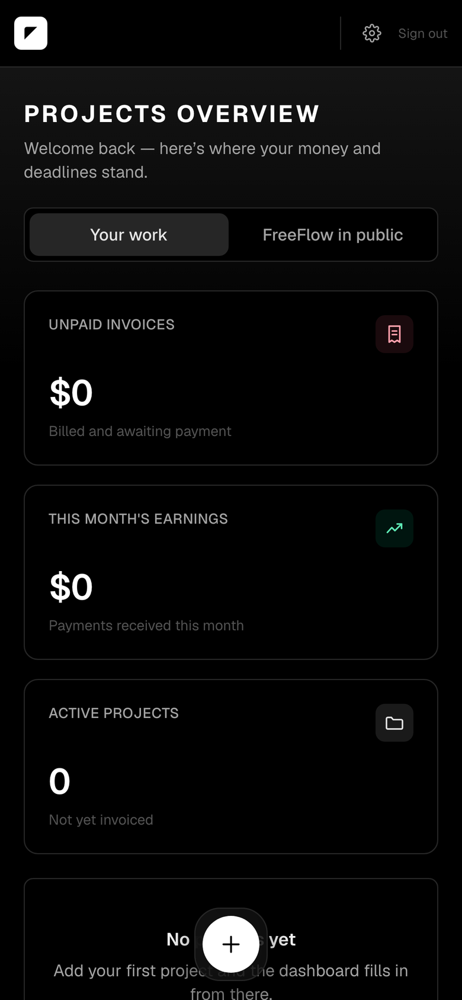

*Phone, first visit after sign-in: the "+" sits on top of "No projects yet". (Tony, 390×844)*

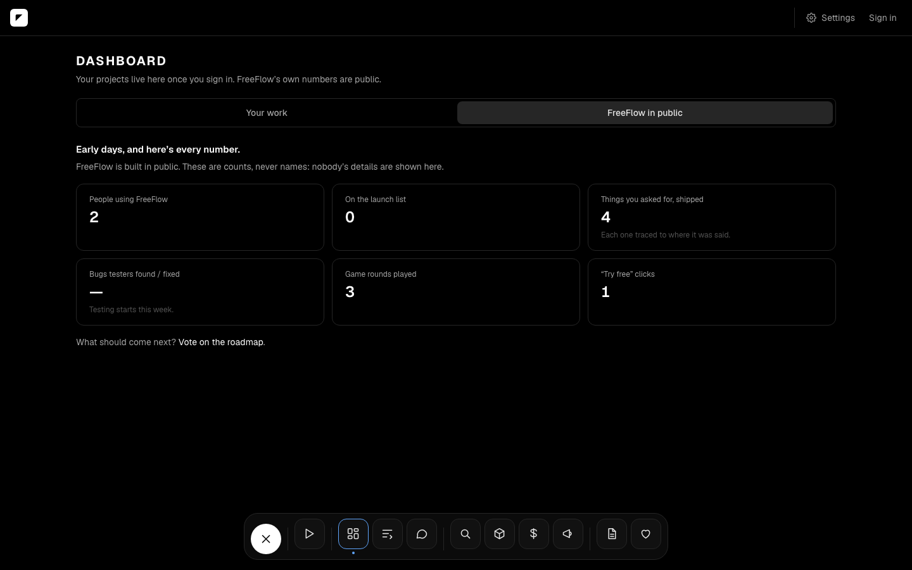

*The Dock opened on desktop: ten icons, names only on hover. (William)*

### H4. "Mark paid" can't be undone or dated

**Seen by:** all 5. **Where:** /dashboard, each project row.

**What happens.**

1. Click "Mark paid" on a project. There is no confirmation, and for about a second nothing visible changes.
2. The row flips to "Paid" and the button disappears. The paid date is always today.
3. Open Edit: Status still says "Invoice sent", and there's no paid/unpaid control. The CSV says "Invoice sent, Paid: Yes".
4. The help desk confirms it can't be undone in the app and says to file a ticket.

Delete, by contrast, does ask first.

**Expected.** A mis-click can be reversed, and the real paid date can be recorded.

**Fix.** Show an Undo toast for a few seconds. Add "Mark unpaid" and a "Paid on" date (default today) in Edit. Make Edit and the CSV show Paid once a project is paid.

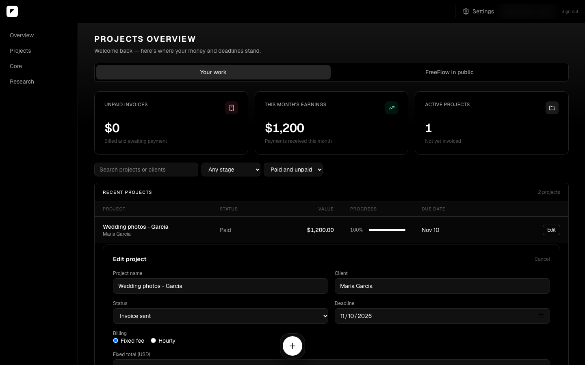

*After Mark paid: the row says "Paid", but Edit still shows Status "Invoice sent", with no way to undo. (Clarisa)*

### H5. Brief extraction drops the fixed budget, currency and client type

**Seen by:** all 5. **Where:** /core ("Paste a brief"), then "Create project".

**What happens.** Every brief that stated a budget lost it: "budget 800 usd", "Our budget is $350", "$1,800 flat", "8,500 MXN" and "$18,500 MXN". Each came back as RATE "not found" and COMPUTED VALUE "needs rate and hours". The model's own note even says "the $350 is a flat budget". "persona moral" and "SA de CV" were not mapped to a company client, so tax withholding is skipped silently. "Create project" then opens with Fixed total empty, and Add fails with "A fixed-fee project needs a total above 0" until the amount is typed by hand. The brief also asks the user to choose between "Save to database" (primary) and "Create project" (secondary); only the second adds anything to the dashboard.

**Expected.** "Paste the message and get a project back", as the home page promises: the budget, its currency and the client type arrive pre-filled.

**Fix.** Extract a fixed total and currency alongside rate and hours. Map persona moral, SA de CV and LLC to a company client. Replace the two buttons with one "Add to my projects".

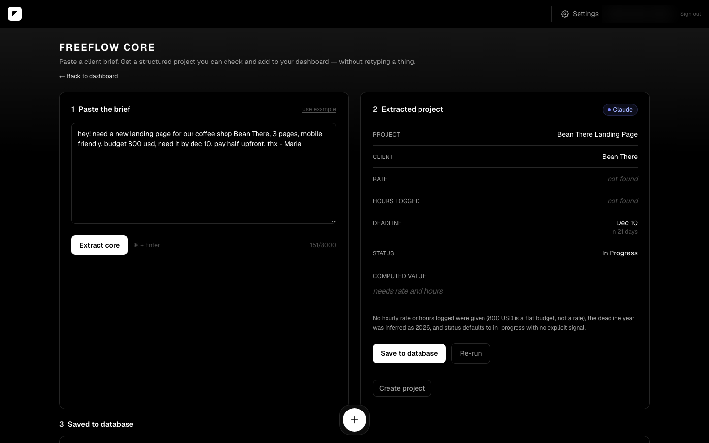

*The brief says "budget 800 usd"; the result says RATE "not found" and "needs rate and hours", and the note leaks "in\_progress". (William)*

### H6. Brief extraction result is lost on reload

**Seen by:** William, Clarisa, Adam, Tony. **Where:** /core.

**What happens.** Reload, or leave and come back, and both the pasted brief and the extracted result are gone with no warning. Each loss costs another paid AI call to get back; Tony lost one this way.

**Expected.** The brief and result survive a reload until the project is added.

**Fix.** Keep both in sessionStorage, and warn before leaving with an unsaved result.

### H7. New project errors show one at a time, off-screen

**Seen by:** all 5. **Where:** /dashboard, New project form.

**What happens.**

1. Fill in nothing (or only the name) and click "Add project" at the bottom of the form.
2. The request goes to the server and fails with HTTP 400.
3. One error appears, such as "Name is required", about 425px above the screen. The page doesn't scroll, and keyboard focus drops to the page body.
4. Client is also required but isn't flagged until the next submit. Some errors are raw developer text: "Too big: expected number to be <=99999999.99".

The form also opens with 12 fields, and the deadline defaults to today, so every quick-added project is instantly "due today".

**Expected.** All problems shown at once, in plain words, next to the fields, with the page scrolled to the first one.

**Fix.** Check required fields in the browser before sending. Show every error at once and move focus to the first. Rewrite raw messages. Show only Name, Client and Amount at first, with the rest under "More details". Leave the deadline empty by default.

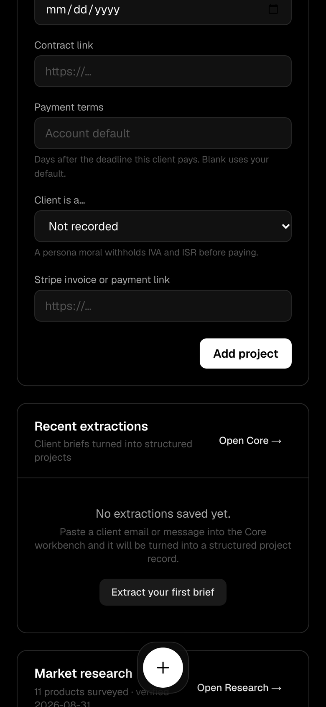

*What Tony sees after tapping "Add project" on an empty form: no message anywhere on screen.*

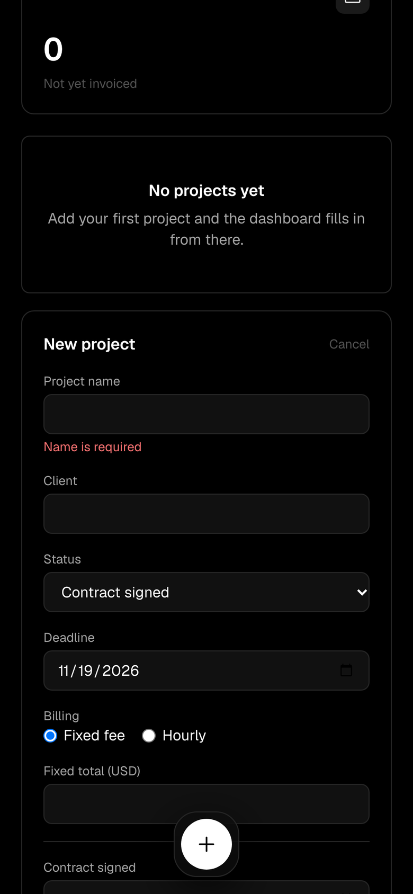

*The only error, "Name is required", sits about 425px above, found only by scrolling up. Client isn't flagged. (Tony, 390×844)*

### H8. Currency switch is invisible and relabels amounts

**Seen by:** Clarisa, Adam, Anton, Tony. **Where:** Settings → Currency, then /dashboard and the CSV.

**What happens.** Switching USD to MXN saves quietly with no confirmation. Every amount still reads "$1,200.00", so nothing visibly changes. The amounts are not converted: $1,200 typed as dollars is now treated as 1,200 pesos, and the CSV header becomes "Amount (MXN)". There is one currency per account, so a freelancer with USD and MXN clients can't record both.

**Expected.** The current currency is visible, and switching doesn't silently change what existing amounts mean.

**Fix.** Show the currency code ("MX$1,200" or "MXN 1,200"). Warn when switching that existing amounts will not be converted. Consider a currency per project.

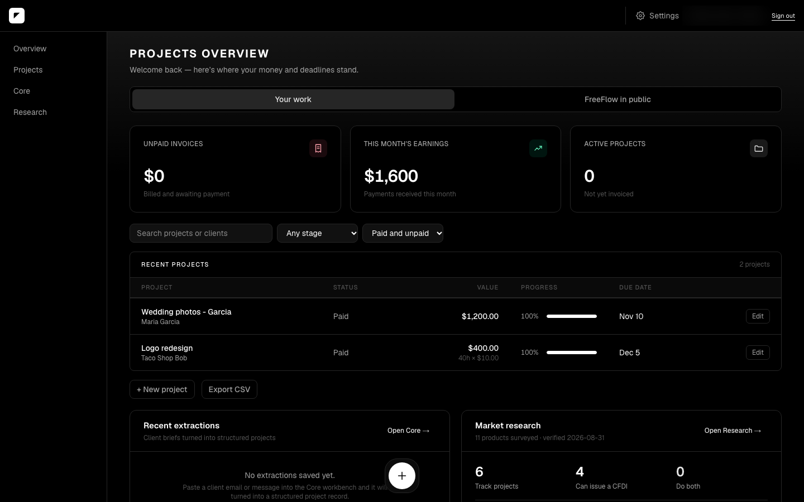

*After switching the account to MXN: every figure still reads "$", with no currency code. (Clarisa)*

### H9. Pricing page never says what FreeFlow costs

**Seen by:** William, Clarisa, Anton, Tony. **Where:** /pricing, /support, the help desk.

**What happens.** /pricing opens as a "PRICING & REVENUE SIMULATOR" with ARR, MRR and churn sliders: "Base case is $32,261 ARR… and falling". The actual answer (free now, one-time purchase at launch) sits in an easy-to-miss box. The story contradicts itself:

- /support says "no plan to put today's features behind a price later", then "Honestly: no, probably not forever". The help desk repeats both.
- "One-time purchase" sits next to subscription tiers at $14/mo, $12/seat and $9/mo.
- The free Solo tier allows "Up to 3 active projects"; Anton had 2 after five minutes.

**Expected.** One sentence, at the top, that answers "what will this cost me?"

**Fix.** Lead /pricing with one line, for example "Free during early access; a one-time purchase at launch, price to be announced". Make /support, the help desk and the tier cards say the same. Move the simulator to its own tab or the build log.

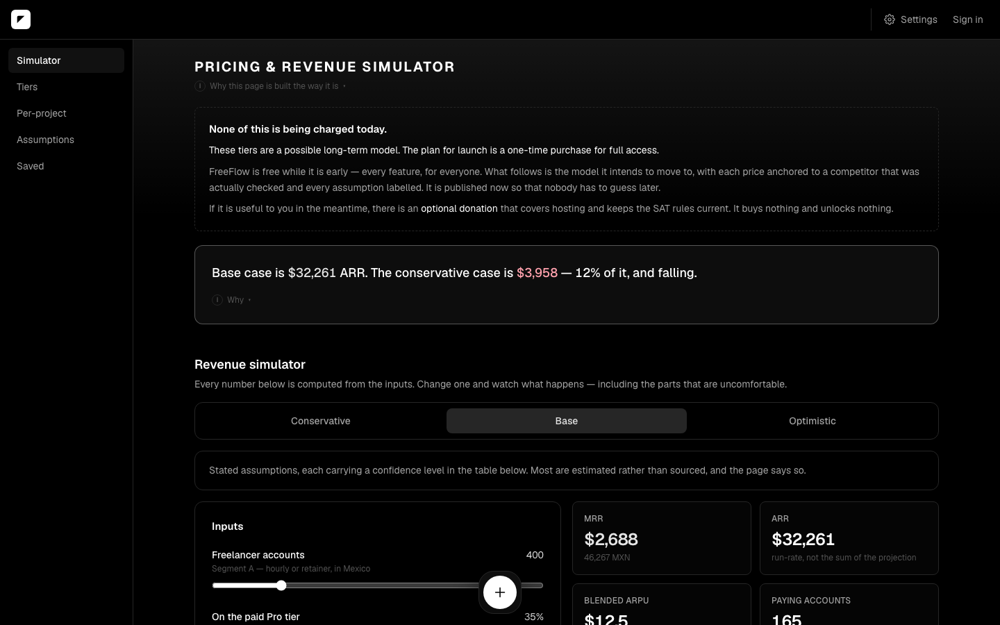

*/pricing opens on revenue projections (ARR, MRR, churn) rather than a price. (Anton)*

### H10. Signed-out dashboard doesn't explain the product

**Seen by:** William, Clarisa, Anton (Adam and Tony noted the tab too). **Where:** /dashboard, signed out.

**What happens.** The page opens on the "FreeFlow in public" tab: "People using FreeFlow 2", "On the launch list 0", "Game rounds played 3". Nothing says what FreeFlow does, and the numbers read as "nobody uses this". The pitch, "Your projects, deadlines and money, in one place", and the sign-up button are on the other tab. This is where William would most likely have left.

**Expected.** A first-time visitor sees what FreeFlow is and how to start.

**Fix.** Open on "Your work" with a one-sentence pitch and a large "Create a free account". Move the public stats lower, or reword them.

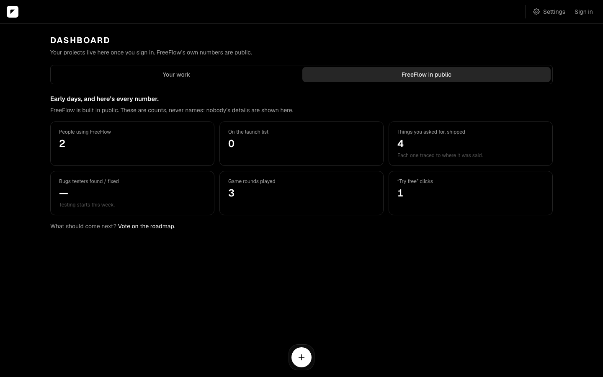

*First screen for a signed-out visitor: "People using FreeFlow 2", "On the launch list 0", and no pitch. (William)*

## Fix next (medium impact)

These hurt trust or usability but don't stop someone from getting started.

### M1. Dashboard money figures contradict each other

**Seen by:** Clarisa, Anton. **Where:** /dashboard and the CSV export.

**What happens.**

- A project shows "9d late" in red, while Expected income expects its money in December ("Assumes payment 30 days after each deadline").
- "This month's earnings $1,200" is gross; the same row says "net $1,144.00".
- One invoice appears as $1,200, $1,392 and $1,144 in different places, with no explanation.
- For one hourly project the CSV says $1,044 while the forecast says $900.
- "ACTIVE PROJECTS 0 · Not yet invoiced" sits beside an invoiced project. A finished job shows "Progress 80%".

**Fix.** Count lateness from the expected payment date (deadline plus terms), or show both dates. Label figures gross or net. Explain invoiced, withheld and received on one invoice. Rename the Active projects sub-label. Drop progress bars that only mirror the status.

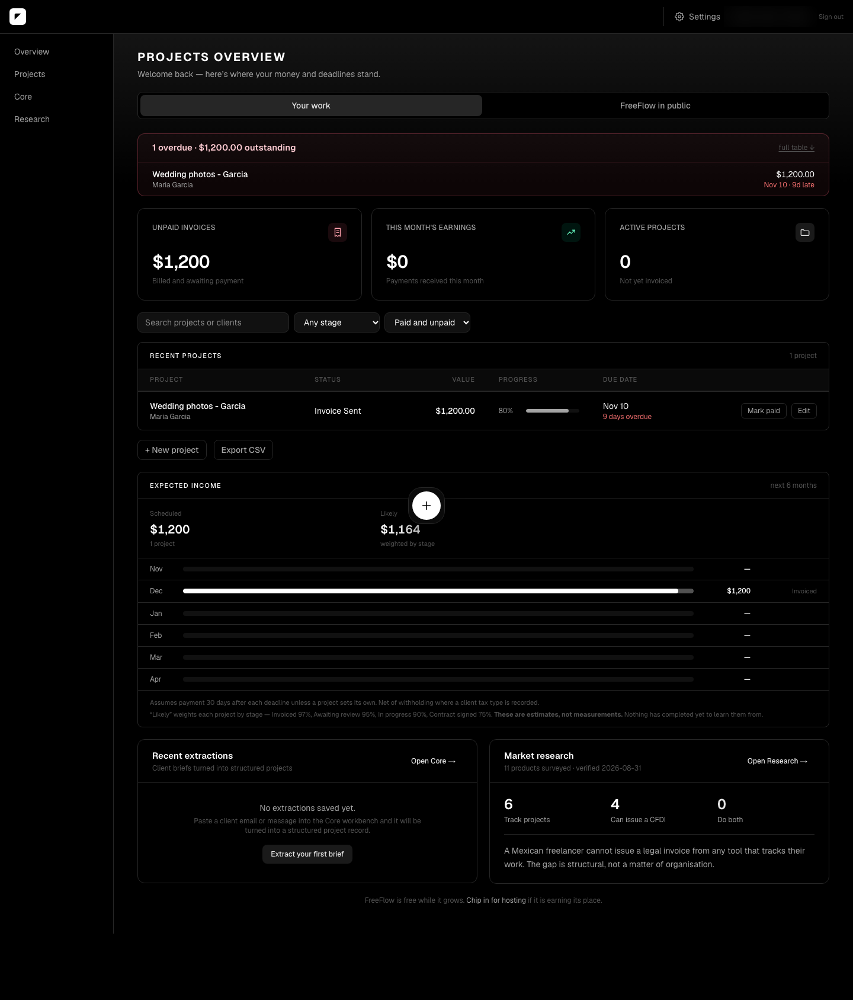

*Top: "Nov 10 · 9d late" in red. Below: Expected income puts the same $1,200 in Dec. Also "ACTIVE PROJECTS 0 · Not yet invoiced" and Progress 80%. (Clarisa)*

### M2. Help desk is hard to reach and sometimes answers the wrong question

**Seen by:** all 5. **Where:** /chat.

**What happens.**

- Signed out, it only says "Help is for people who use FreeFlow", so nobody stuck at sign-up can ask.
- Signed in, you click two chips ("How do I use…", then a topic) before a text box appears.
- "How do I undo Mark paid?" got instructions for marking a project paid ("Answer from rule: record-payment"). A question about bulk delete and shortcuts got an unrelated answer about editing one project. Both were logged as answered.
- Internal rule names show under each answer ("Answer from rule: …").
- Reloading the page wipes the conversation.

**Fix.** Show a text box immediately, with the chips as shortcuts. Allow basic questions when signed out. Keep the conversation across reloads. Hide rule names. Fix the two misroutes, and don't count an off-topic answer as answered.

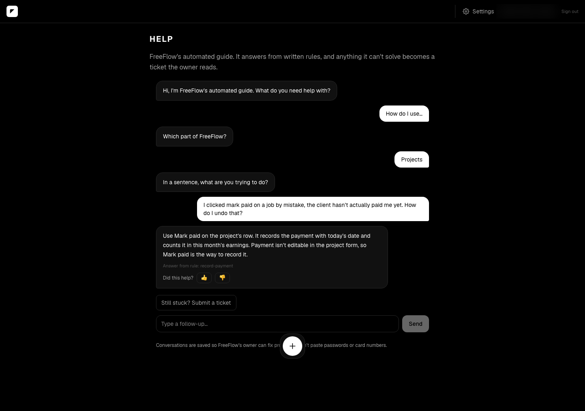

*Asked how to undo Mark paid, the help desk explains how to mark paid ("Answer from rule: record-payment"). Note the two chips clicked before typing. (Clarisa)*

### M3. "Sort it for me" can't be clicked with a mouse or finger

**Seen by:** William, Clarisa, Adam. **Where:** the home page and /demo hero.

**What happens.** After picking a role, the "Sort it for me" button is parked off-screen and only appears when reached with the Tab key. Mouse and touch users never see it; every click attempt timed out. With the keyboard it works: the notes sort into a checklist and "ON YOUR MIND" drops to 0. The role colour dots also have no visible labels.

**Fix.** Make it an ordinary visible button, and label the role dots.

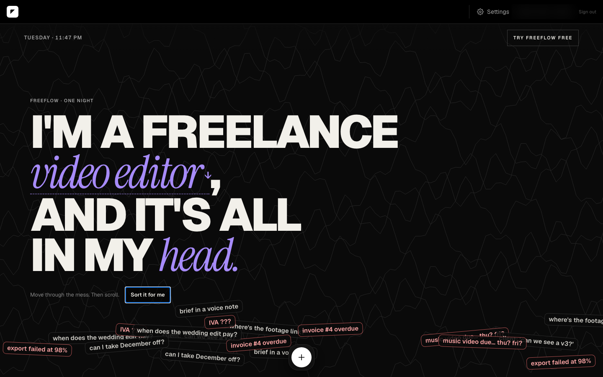

*"Sort it for me" appears only after pressing Tab. A mouse or touch user never sees it. (Adam)*

### M4. Public pages read like a course project

**Seen by:** Clarisa, Anton. **Where:** /product, /pricing, /docs, /marketing, /research.

**What happens.**

- /product stamps "Week 0/2/3" and "After Week 3" on every card.
- /pricing says "Excluded from the Week 3 model" and "That number was submitted and it still holds".
- /docs publishes raw AI prompts with typos: "I dont what you mean by the small studio…", "train the bot the properly answer questions", "according to the rubric".
- The revenue simulator, "MARKETING ENGINE" and "Research & Benchmarking" sit in the main menu. Even the private dashboard has a "Market research" widget.

**Fix.** If graders need these pages, group them under a clearly labelled "Build log", away from customer pages. Remove "Week", "rubric" and "submitted" from customer-facing copy, and fix the prompt typos.

### M5. No privacy, terms or contact pages; plain white 404

**Seen by:** Adam, Anton. **Where:** /privacy, /terms, /about, /contact and any unknown URL.

**What happens.** /privacy, /terms, /about, /contact, /robots.txt and /sitemap.xml all return 404. The help desk confirms there are no privacy or terms pages. Only the home page has a footer, with no legal links. Sign-up has no consent line, and the only contact is a personal Gmail address. Unknown URLs show the stock white Next.js 404, with no link home, on an otherwise all-black site.

**Fix.** Publish Privacy and Terms and link them in a site-wide footer. Add a consent line to sign-up and a domain contact address. Add a branded 404 with a link to the dashboard.

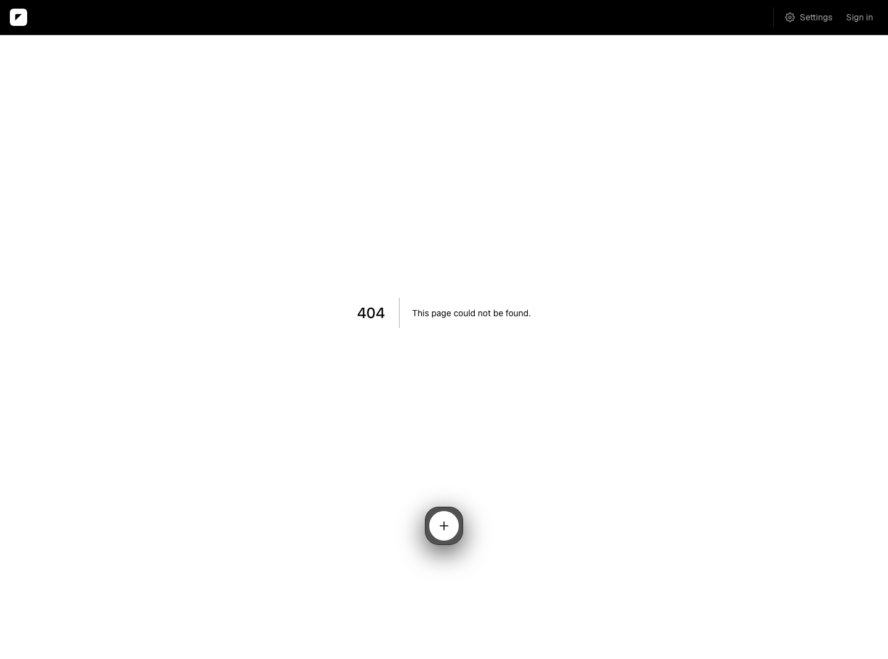

*Any unknown URL: the stock white 404, with no link home. (Adam)*

### M6. FreeFlow can't create or send invoices

**Seen by:** William, Anton. **Where:** the help desk, /product.

**What happens.** Asked how to invoice a client, the help desk said FreeFlow "tracks invoices but doesn't create or send them", and that legal Mexican invoices (CFDI) aren't built yet. For William, who came to bill clients, this was the point to quit. The dashboard's own research widget says Mexican freelancers can't issue legal invoices from any tool that tracks their work, which FreeFlow can't do either.

**Fix.** Say plainly on the home page and /pricing that FreeFlow tracks invoices and doesn't send them yet. Treat invoice creation as a roadmap item to validate.

### M7. Mobile: small tap targets, zooming inputs, squashed search

**Seen by:** Tony. **Where:** every page at 390×844.

**What happens.**

- The dashboard search box ("Search projects or clients") is squashed to 44px wide, so typed text can't be read.
- Every input uses 14px text, so iOS Safari zooms in whenever one is tapped.
- Many tap targets are under 44×44: "Sign out" 42×17 right next to the 36×28 Settings gear, "Mark paid" and "Edit" 26px tall, "Delete project" 77×16, "Why ▾" 16px tall, radio buttons 13×13.
- The New project form starts about 1,500px down the page, with no add button near the top.
- /core shows a "⌘ + Enter" hint on a phone.

**Fix.** Make the search box full width on mobile. Use at least 16px input text. Make tap targets at least 44×44. Add a "+ New project" button near the top. Hide keyboard hints on touch devices.

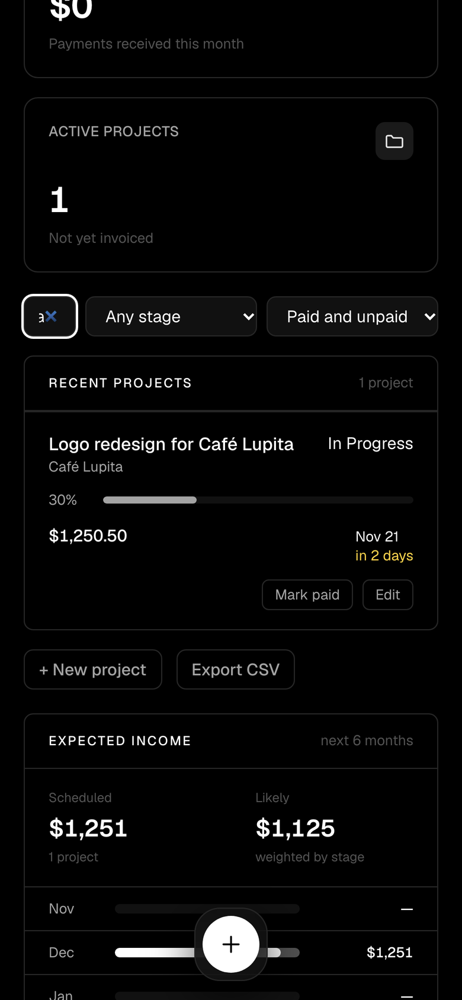

*After typing "lupita" into search: only "a" and the clear button fit. (Tony, 390×844)*

### M8. Unsaved work is lost without warning

**Seen by:** William, Clarisa, Adam, Tony. **Where:** New project, Edit, /core, /chat.

**What happens.** A refresh or the Back button silently throws away a half-filled New project form, unsaved Edit changes, a brief and its extraction (H6), and the help desk conversation.

**Fix.** Autosave drafts in the browser, or warn before leaving with unsaved changes.

### M9. Jargon and internal names shown to users

**Seen by:** William, Clarisa, Anton. **Where:** Settings, dashboard, /core, /pricing, /docs, /chat.

**What happens.** Terms a casual user won't know: IVA, ISR, CFDI, SAT, RESICO, retenciones, persona física/moral, materialidad, ARR, MRR, ARPU, churn, Supabase, row-level security. Raw database values leak into text: "status was inferred as in\_progress", "hours\_logged is null". "Mexican tax regime" defaults to "Régimen general" for every user, even outside Mexico.

**Fix.** Plain-language labels with the official term in a tooltip. Never show field names. Leave the tax regime unset until the user says they invoice in Mexico.

### M10. One feature goes by many names

**Seen by:** William, Clarisa, Anton. **Where:** Dock, sidebar, /core, help desk.

**What happens.** Brief extraction is called "Paste a brief" (Dock), "Core" (sidebar), "FREEFLOW CORE" (heading), "Brief extraction" (help and /product), "Extract core" (button) and "Recent extractions". The help page is "Help desk", "HELP" and "automated guide". The sign-up button has five labels: "TRY FREEFLOW FREE", "START FREE now →", "Create a free account", "Create an account", "Create account".

**Fix.** Pick one plain name per feature and one sign-up label, and use them everywhere.

### M11. A long project name breaks the dashboard layout

**Seen by:** Adam. **Where:** /dashboard projects table.

**What happens.** A 120-character project name with no spaces (the field's maximum) makes the page 1,910px wide on a 1,440px screen. The Value, Progress, Due date and Actions columns are pushed off-screen, and the overdue banner overflows too.

**Fix.** Let long words wrap inside table cells.

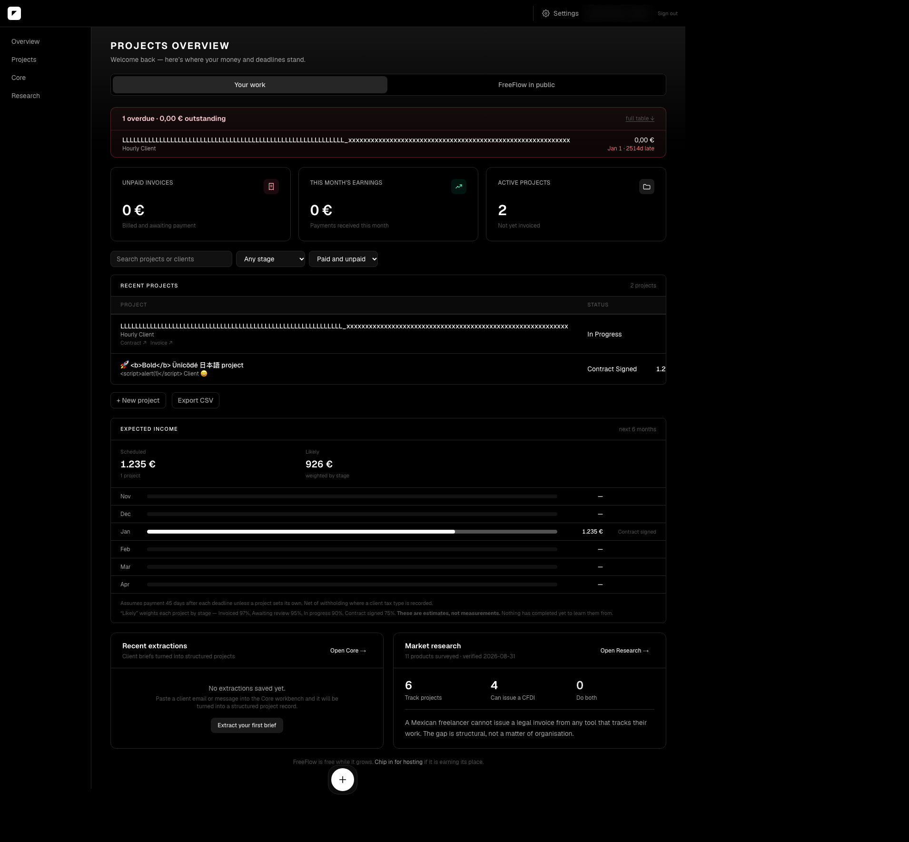

*A 120-character name widens the page to 1,910px; Value, Due date and Actions fall off the right. The banner also shows a 0,00 € project and "Jan 1 · 2514d late" with no year (M12). (Adam)*

### M12. Zero-value projects are accepted; old dates show no year

**Seen by:** Adam. **Where:** New project and Edit, hourly billing.

**What happens.** Hourly rate "0.001" and hours "1e3" are accepted, saving a project worth 0.00. Fixed-fee projects, by contrast, must be above 0. A 2020 deadline shows as "Jan 1 · 2514d late", with no year.

**Fix.** Require an hourly total above 0, or warn. Show the year on any date outside the current year.

### M13. Keyboard focus gets lost

**Seen by:** Adam, Tony. **Where:** dashboard, Settings, /chat.

**What happens.**

- Focus drops to the page body after "+ New project", after a failed submit, and after each help desk chip.
- The Settings drawer doesn't take focus when it opens; the first Tab lands on "Sign in" in the header.
- Escape doesn't close the Edit form.
- Dashboard tabs ignore the arrow keys.
- The Settings gear has no accessible name, and there's no skip-to-content link.

**Fix.** Move focus into drawers and forms when they open, and to the first error on a failed submit. Let Escape close Edit. Support arrow keys on tabs. Name the gear button. Add a skip link.

### M14. Sign-up and login show raw server errors

**Seen by:** Adam. **Where:** /signup, /login.

**What happens.** Both forms turn off the browser's own checks, so "abc@", a 5-character password or a 300-character email go to the server. The replies are shown raw: "Unable to validate email address: invalid format", "An email address is too long". Errors stay on screen after the fields are fixed. Neither form puts the cursor in the first field.

**Fix.** Check email format and password length in the browser, with plain messages. Clear errors on edit. Autofocus the email field.

### M15. A malformed project ID returns a server error (500)

**Seen by:** Adam. **Where:** the projects API.

**What happens.** Saving changes to a project ID that isn't a valid ID (for example "not-a-uuid") returns HTTP 500 "Could not save. Please try again.". A well-formed but unknown ID correctly returns 404 "Project not found."

**Fix.** Check the ID's format first and return 404 for anything malformed.

## Polish (low impact)

Small fixes, several of them one-liners. L1 is worth doing with H2, since every tester saw it.

### L1. Email address breaks mid-word on the confirm page

**Seen by:** all 5. **Where:** /verify-email. The address wraps as "…@gmail.c" / "om" (on mobile "…@gma" / "il.com"). **Fix:** allow the line to break only after "@".

### L2. Home page notes overlap

**Seen by:** William, Clarisa, Anton, Tony. **Where:** / and /demo. The floating worry notes pile on top of each other, some appear twice ("ISR ???", "client gallery due"), and they become unreadable at 390px. The sticky "TUESDAY · 8:00 AM" clock overlaps "8:00 AM · GOOD MORNING". **Fix:** give the notes fixed, non-overlapping positions on small screens and remove the duplicates.

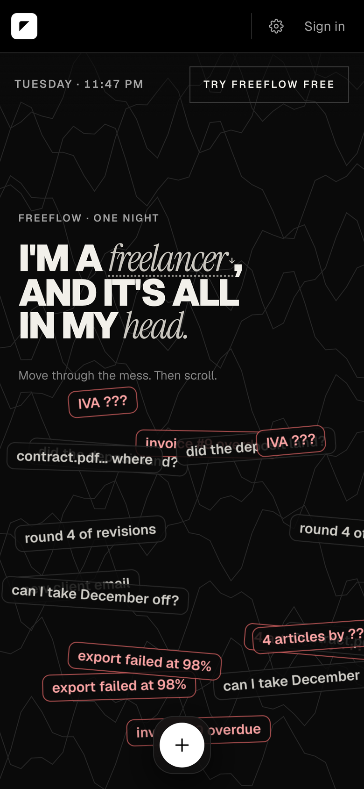

*Home page at 390px: the worry notes pile on top of each other. (Tony)*

### L3. Two logos, five sign-up labels, "Welcome back" for new users

**Seen by:** William, Anton. Sign-in pages use an "F" tile logo; the rest of the site uses a slanted glyph. A brand-new account is greeted with "Welcome back". /demo is the same page as / under another title. **Fix:** one logo, one sign-up label (see M10), "Welcome" on a first visit.

### L4. Small copy and number mistakes on /pricing and /product

**Seen by:** Adam, Anton, Tony.

- "Three tiers" sits above four cards; "Two segments" above three plus a fourth.
- "BLENDED ARPU $12.5" should read $12.50.
- Peso amounts use a bare "$" ("≈ $155", "≈ $1,487").
- /product says "1 built · 2 planned", then "None of this is built."
- The Saved tab says "Adjust the simulator above", but the simulator is on another tab.
- Status casing differs: "In Progress" in the table, "In progress" in the dropdown.
- The public stats show "People using FreeFlow 7" beside "Try free clicks 2" (the 5 test accounts raised the first number).

### L5. Sign-out and sign-in land on the wrong page

**Seen by:** William, Clarisa, Adam. Signing out lands on "Create your account". Signed out, /core ("Paste a brief") redirects to sign-up with no explanation, and after signing in you land on /dashboard, not back on /core. **Fix:** send sign-out to /login or the home page, explain the redirect, and return people to the page they came from.

### L6. No bulk actions or keyboard shortcuts

**Seen by:** Adam. There are no row checkboxes, no bulk Mark paid, Delete or Export, and no shortcuts beyond ⌘+Enter on /core ("/", "n", ⌘K and "?" do nothing). Saved pricing scenarios can't be renamed or deleted. **Fix:** worth adding once there are users with many projects.

### L7. Payment-terms setting can't be emptied

**Seen by:** Adam. **Where:** Settings → Default payment terms. Clearing the field snaps it to "0", so typing then gives a leading zero ("-5" becomes "05"). **Fix:** allow an empty field while typing.

### L8. Pricing sliders jump on touch

**Seen by:** Tony. **Where:** /pricing. The sliders are 16px tall, and a short drag on "Freelancer accounts" jumped from 400 to 1,390. There's no way to type a value. **Fix:** taller touch area, and a number field beside each slider.

### L9. Resend link trusts the address in the URL

**Seen by:** Adam, Anton. **Where:** /verify-email. The page shows whatever ?email= says, and "Resend the link" sends to that address. It is escaped (no script injection) and only reaches accounts that signed up and never confirmed, so the risk is low. The full email also sits in the URL, where it reaches browser history and analytics. The resend cooldown resets on refresh. **Fix:** keep the email out of the URL, and add a per-visitor rate limit on resend.

### L10. Demo page keeps loading and shows "Try free" when signed in

**Seen by:** William, Clarisa. **Where:** /demo, signed in. The page never stops making network requests, and it still shows "TRY FREEFLOW FREE" to a signed-in user. **Fix:** check what keeps polling, and swap the button for "Open dashboard" when signed in.

## What worked well

Keep these intact while fixing the rest.

- **Speed.** Public pages load in 0.2–0.75s and signed-in pages in about 1–2s. Only brief extraction is slow (3–4.6s), and it shows "Extracting…" while it works.
- **No duplicate submits.** About ten different buttons were double-clicked; each sent exactly one request. "Creating…", "Saving…" and "Sent ✓" states are clear.
- **Odd input is safe.** HTML, script tags, emoji, accents and Japanese text are saved and shown as plain text. Names are trimmed. The CSV export defuses spreadsheet formulas. The extractor ignored a hidden "ignore previous instructions" line.
- **The core loop.** Adding a project, the overdue banner, the six-month forecast, the Mexican withholding breakdown (arithmetic checked: $1,200 + 16% IVA = $1,392, minus $128 IVA retenido and $120 ISR = $1,144) and the CSV export all do what they say.
- **Sign-up and confirm page.** Two fields, fast, and robust to refresh, Back and a missing address. Settings chosen before sign-up carry over and follow the account to other devices.
- **Search and filters** live in the URL, so they can be bookmarked; the empty state says how many projects the filter hides.
- **Delete asks first,** with a friendly "Keep it".
- **Mobile basics.** No sideways scrolling on any page, proper field labels, and number keypads on money fields.
- **Honest copy.** "27 of 32 capabilities are built. 5 are not." and "These are estimates, not measurements." won over Anton, the most skeptical tester.

## Notes for whoever picks this up

- **Check the live site after deploying.** Several findings (H1, parts of H9) may disappear once week6 is live. Re-test against the deployed site before fixing anything twice.
- **Test accounts.** Five +test accounts (test1–test5) exist on production with sample projects, a saved extraction, a saved pricing scenario and one roadmap vote. Delete them when done, or the public stats stay inflated.
- **Raw material.** user-testing-report.md in the project root holds each tester's full notes (about 17,000 words), with every log line and screenshot reference.
- **Screenshots.** The images in this file are in screenshots/ next to it, with email addresses blurred. The full set of 404 originals sits in a temporary folder and will be cleared eventually.
- **AI cost.** The test used 13 brief extractions and 8 help desk messages.
