# Week 4: Marketing Engine + Content System (Submission Packet)

**Student:** Brayden Credeur · **Course:** Negocios Inteligentes y Comercio Digital, Ibero CDMX · **Project:** FreeFlow · **Date:** October 2026

**Objective:** build a practical marketing engine and upgrade the homepage into a credible product landing page.

---

## Required Links

| Item | Link |
|---|---|
| **Live page: /marketing** | https://www.freeflow.website/marketing |
| Upgraded homepage | https://www.freeflow.website |
| **GitHub** | https://github.com/BraydenEC/FreeFlow |
| **Demo video** | ⬅️ PASTE YOUR VIDEO LINK HERE |

---

## Requirements Checklist

Every required feature and coding task from the Week 4 brief, and where it can be checked.

| Required feature | Where it is | Status |
|---|---|---|
| Homepage upgraded | `/` signed out is a full landing page (`components/landing/LandingPage.tsx`, `64ab64d`) | ✅ See note below |
| Brand system | Monochrome tokens in `app/globals.css`, documented in `docs/week4/BRAND.md`, shown on `/marketing` | ✅ |
| Target persona | The Week 2 interviewee, quoted verbatim, on `/marketing` (`lib/marketing/persona.ts`) | ✅ |
| Landing page copy | Homepage headline "Know what is coming, not just what you are owed.", plus what is and is not built | ✅ |
| 10 social posts | Ten content cards on `/marketing` | ✅ |
| 3 video scripts | Three cards, each with hook, body and CTA | ✅ |
| 14-day campaign calendar | Derived from the posts and scripts (`buildCalendar`) | ✅ |
| A/B headline test | Two live tests on `/marketing`; the chosen winner persists | ✅ |
| Saved marketing assets | `marketing_assets` table, per-user RLS, Save buttons | ✅ |

| Required coding task | Where it is | Status |
|---|---|---|
| Upgrade homepage | `app/page.tsx` branches on the session; `LandingPage.tsx` | ✅ |
| Create /marketing page | `app/marketing/page.tsx` | ✅ |
| Create content cards | `components/marketing/MarketingWorkbench.tsx` | ✅ |
| Add A/B tester | `lib/marketing/ab.ts` + `ab-store.ts` | ✅ |
| Add copy/export buttons | Copy on every card; Export CSV through the existing formula-injection-safe writer | ✅ |
| Save marketing assets | `POST /api/marketing/save` → `marketing_assets` | ✅ |

**Note on the homepage.** The landing page was built on 2026-09-24 (`64ab64d`), four days before the Week 4 plan, when the product was renamed FreeFlow. The plan found it already met the brief, so Week 4 reused it instead of rebuilding it. Week 4 restored its brand (`8a9a4e2`), verified it in production (C2), and used its headline as the control in A/B test 1.

---

# Build Discipline Packet

*Gate 1: committed on 2026-09-28 (`1ae512f`) before any Week 4 code, in `docs/week4/PLAN.md`. Condensed here in the order of the assignment's packet table.*

## 🧩 Problem: what user problem is this feature solving?

FreeFlow is free and needs users, and it had no way to reach them: nothing to post, no documented brand, no persona artifact, no campaign, and no way to produce, save or export marketing copy. A product with no distribution is good work that nobody sees.

There is a second problem. Marketing copy is the easiest place in a project to lie, to a prospect and to yourself. So the rule for this week: every claim must trace to something real (the validated persona or a built feature), and generated copy must say it was generated.

## 👤 User: who will use it?

| User | Need |
|---|---|
| **The founder, as marketer** | Ready-to-post content and a 14-day plan, fast, and exportable |
| **The prospective freelancer** | A landing page that says what the product is, and is not, before asking for an email |

**The persona is validated, not invented.** It is the freelancer interviewed in Week 2: a per-project installer who finds clients by cold outreach, bills a fixed fee per job, and said he would rather rent something maintained than build it himself. His one complaint about the product, verbatim:

> *"kinda what u got just its annoying on mobile"*

## 🎯 Success: what must work by the end of the week?

`/marketing` live; brand system documented; persona on the page; 10 social posts, 3 video scripts and a 14-day calendar as content cards; an A/B headline tester that records a winner; copy and export buttons; assets saved per user in Supabase; 2 A/B tests + 3 software tests passing; homepage confirmed upgraded.

**Result: achieved.** All 14 acceptance criteria pass (below).

## 🖼 UX Concept: image mockup + implementation note

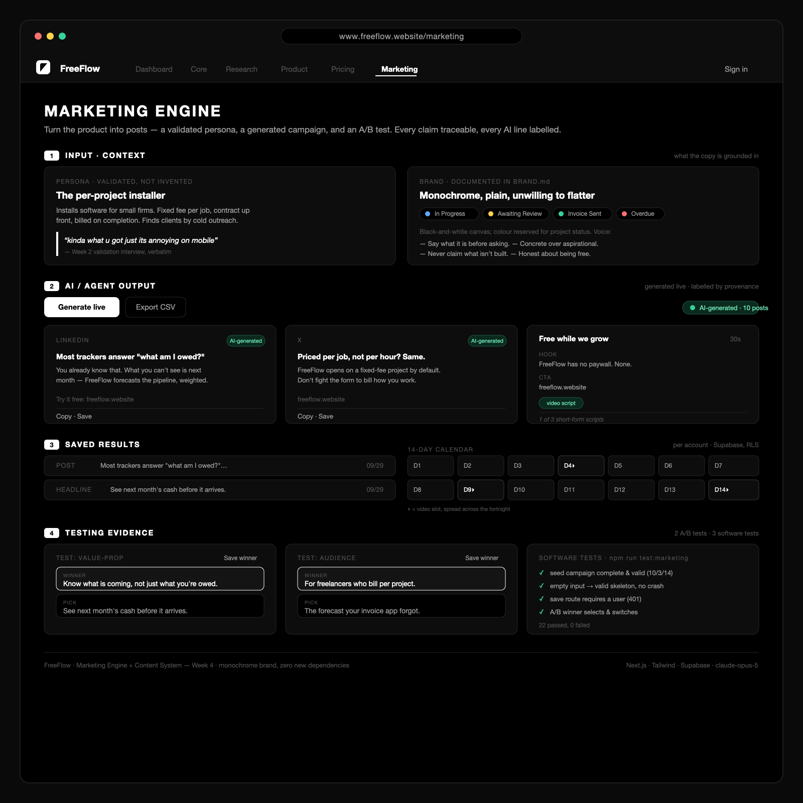

*The mockup covers the four zones the course UX prompt asks for: (1) input/context, (2) AI/agent output, (3) saved results, and (4) testing evidence. It is drawn in FreeFlow's real monochrome brand. Source: `docs/week4/mockup.svg`.*

**Implementation note.** `/marketing` is one page in bands that follow the mockup top to bottom, built from the product's existing cards, tabs and monochrome system so it reads as part of FreeFlow rather than a bolt-on. Three divergences:

1. **The mockup was drawn, not image-generated.** The plan said it would come from an AI image generator. A generic generated image would not have matched the brand the week had just restored, so it was drawn as SVG in the real tokens instead.
2. **The calendar got its own band.** Beside the saved list, fourteen slots were cramped.
3. **The software-test checklist is not on the live page.** It means nothing to a visitor, so it lives in the test evidence. The two A/B tests stay on the page as working tools.

## ✂️ Scope Cut: what looked nice but will not be built this week?

| Cut | Why |
|---|---|
| Publishing straight to social networks (Buffer, Mailchimp, X API) | The brief is a content *engine*, not a *publisher*. Posting is a different product, the same reasoning that cut Stripe checkout from Week 3 |
| Image generation for posts | Text only. Post images are a separate capability and a separate cost |
| Analytics on the A/B test | The tester records a chosen winner. Click-through rates need traffic that does not exist yet; inventing it would be making numbers up |
| A new visual identity | The product already had one. This week documents and repairs it rather than replacing it |

## 🧱 Product Spec: requirements and acceptance criteria

| # | Criterion | Pass condition | Result |
|---|---|---|---|
| C1 | `/marketing` loads in production | HTTP 200 | ✅ PASS |
| C2 | Homepage still upgraded | `/` renders the landing page signed out | ✅ PASS |
| C3 | Persona rendered | Named, with the verbatim quote | ✅ PASS |
| C4 | Brand system present | On the page and documented in `BRAND.md` | ✅ PASS |
| C5 | 10 social posts render | Ten distinct cards | ✅ PASS |
| C6 | 3 video scripts render | Three cards, each with hook, body and CTA | ✅ PASS |
| C7 | 14-day calendar renders | Fourteen slots, each pointing at a real asset | ✅ PASS |
| C8 | **Generated content is labelled** | Provenance badge on every card | ✅ PASS |
| C9 | Copy button works | Writes the card's text to the clipboard | ✅ PASS |
| C10 | Export works | Downloads a CSV of the campaign | ✅ PASS |
| C11 | A/B test records a winner | The choice persists | ✅ PASS |
| C12 | **Saved asset round-trips** | Save, reload, the row is shown | ✅ PASS (201, verified 2026-10-07) |
| C13 | Degenerate input handled | Empty or garbage never crashes the page | ✅ PASS |
| C14 | Works with no database | Page renders seed content | ✅ PASS |

## 🏗 Architecture: frontend, backend, database, data flow

```
  BROWSER                         SERVER (Vercel)                     DATABASE (Supabase)
  ───────                         ───────────────                     ───────────────────
  /marketing  ◄── renders ──────  app/marketing/page.tsx
  (server page, seed campaign       reads persona + brand from lib/
   + saved list)                    reads saved list ──────────────►  marketing_assets
                                                                      (per-user RLS)
  MarketingWorkbench (client)
   │ Generate live ─────────────►  POST /api/marketing/generate
   │                                 rate limited (8/min per client)
   │                                 Claude (claude-opus-5) → validate
   │                                 invalid or no key → seed copy
   │ ◄── campaign + provenance ──    "model" | "heuristic"
   │
   │ Copy / Export CSV  (in the browser, no server)
   │ A/B choice (remembered in the browser)
   │
   │ Save / Save winner ────────►  POST /api/marketing/save
                                     1. signed in?  no → 401
                                     2. payload valid? (zod)
                                     3. insert as the user ──────────► marketing_assets
```

**Frontend:** a Next.js server page with one client component for the interactive parts. **Logic:** `lib/marketing/` is pure TypeScript with no React and no I/O: persona, seed campaign, calendar builder, validator and A/B chooser. The page and the tests run the same code. **Backend:** two route handlers. Generate is public but rate limited; save checks the session *before* reading the body. **Database:** one table, `marketing_assets`, with content stored as `jsonb` (a post, a script and a headline have different shapes) and a provenance column on every row.

**Two rules carried from earlier weeks.** *Provenance:* every generated line is labelled, the rule `/core` has used since Week 1. *Null-safety:* no API key gives seed copy, no database gives an empty saved list, invalid model output gives seed copy. The page renders a complete campaign in every failure mode.

## 🧰 Tech Stack: tools, libraries, services, and why

| Layer | Choice | Why, and what was rejected |
|---|---|---|
| Framework | Next.js 16 (App Router) + React 19 + Tailwind v4 | The course stack, already in place |
| Content generation | Existing `@anthropic-ai/sdk`, `claude-opus-5`, structured output checked with zod | *Rejected:* a second AI vendor, with no reason to add one. *Rejected:* simulated output. Real output, labelled anyway |
| Storage | Supabase `marketing_assets`, `jsonb` content | *Rejected:* a column per content type, which would be mostly empty |
| A/B mechanism | Deterministic chooser + saved choice | *Rejected:* an experimentation platform, which needs traffic |
| Export | The project's existing formula-injection-safe CSV writer | *Rejected:* a second export path |
| Copy | The browser's `navigator.clipboard` | *Rejected:* a clipboard library |
| Rate limiting | Zero-dependency in-memory limiter | *Rejected for now:* Upstash Redis, the upgrade path once traffic justifies a new service |

**Net new third-party dependencies this week: zero**, the seventh week running.

## ⚙️ DevOps: GitHub, Vercel, Supabase, env variables, deployment plan

- **GitHub:** `main` branch, every change a described commit. 10 Week 4 commits from Sept 28–30.
- **Vercel:** auto-deploys every push to `main`: **10 production deployments** from Sept 28–30, recorded in GitHub's deployment history. `/marketing` was deployed as soon as it rendered, before the evidence documents, to clear the "no live page" grade cap early.
- **Supabase:** one new migration, `supabase/marketing_assets.sql`. It is safe to re-run and ends with a verify query. Applied and confirmed: the table exists, and a signed-out query returns nothing.
- **Environment variables:** **none new.** It reuses `ANTHROPIC_API_KEY`, which is server-side only and never `NEXT_PUBLIC_`.

## 🧪 Test Plan: how will you verify it works?

| # | Type | Test | Result |
|---|---|---|---|
| **A/B 1** | A/B | Value-prop test: choosing a winner returns it, and it belongs to that test | ✅ PASS |
| **A/B 2** | A/B | Audience test: switching updates the winner; unknown ids fall back safely | ✅ PASS |
| **SW 1** | Software | Campaign complete: 10 posts, 3 scripts, 14 days, no empty fields, no dangling calendar slots | ✅ PASS |
| **SW 2** | Software | Empty, garbage or broken model input yields a valid skeleton or a clean rejection, never a crash | ✅ PASS |
| **SW 3** | Software | Save requires a signed-in user, checked before the payload | ✅ PASS (HTTP 401 live) |

**The two A/B tests**, both live on `/marketing`:

| Test | Variant A | Variant B | What it decides |
|---|---|---|---|
| A/B 1, value proposition | "Know what is coming, not just what you are owed." (current homepage) | "See next month's cash before it arrives." | Which promise leads the landing page |
| A/B 2, audience | "For freelancers who bill per project." | "The forecast your invoice app forgot." | Name the user, or name the competitor's gap |

**22 automated assertions pass** (`npm run test:marketing`); the whole project runs **619 across 14 suites, 0 failed**. Full raw output and the six production checks are in the Test Evidence section below.

## 🤖 Coding Agent Prompt: exact prompt to Claude Code

*The packet reserved this section for after Gate 1. Below is the scoped implementation prompt for the agreed features, written from the packet. The individual prompts as given are in the Prompt Log.*

```
Build the Week 4 Marketing Engine for the existing FreeFlow app (Next.js 16, Tailwind v4, Supabase, deployed on Vercel). Implement only the agreed scope. Read node_modules/next/dist/docs/ before writing code, because this Next.js version has breaking changes.

1. Logic first, with tests. In lib/marketing/, with no React and no I/O: the persona (the Week 2 interviewee, quoted verbatim, never an invented one); a seed campaign of 10 posts, 3 video scripts (hook, body, CTA) and two A/B headline pairs, every claim traceable to the persona or a built feature; buildCalendar, which derives a 14-day schedule from the posts and scripts; validateContentSet, which rejects short counts, empty fields and calendar slots pointing at missing assets; and pickHeadlineWinner. Write scripts/test-marketing.ts alongside: 2 A/B tests and the software tests.
2. The page. /marketing as a server component in bands: context (persona + brand), content cards, 14-day calendar, A/B test, saved assets. It must render a complete campaign with no API key and no database.
3. Generation. POST /api/marketing/generate calls claude-opus-5 with structured output, validates the result, and falls back to the seed campaign if the key is missing or the output fails validation. It always returns provenance: "model" | "heuristic", and every card shows that as a badge.
4. Interactivity. Copy-to-clipboard on each card; Export CSV using the existing formula-injection-safe writer; an A/B tester whose choice persists without hydration mismatches.
5. Saving. POST /api/marketing/save checks the session first (401) and then validates the payload with zod. A new marketing_assets table with jsonb content and a provenance column, with RLS scoping all four verbs to auth.uid(). The migration is idempotent and ends with a verify query.
6. Add /marketing to the navigation and the feature map, so the route drift test covers it.

Constraints: zero new dependencies; no new environment variables; lint, build and the full test suite must pass before each commit. Out of scope: real publishing, post images, A/B analytics, a new visual identity.
```

---

# Weekly Submission Packet: Evidence

| Item | Required | Delivered |
|---|---|---|
| 🌐 Live URL | Working deployed page | ✅ https://www.freeflow.website/marketing (HTTP 200) |
| 🧩 Build Discipline Packet | Complete before coding | ✅ Committed before any Week 4 code (`1ae512f`) |
| 🖼 UX Image / Mockup | Image or wireframe | ✅ `marketing-mockup.png` + implementation note (above) |
| 🧱 Product Spec | Requirements + acceptance criteria | ✅ 14 testable criteria, 14 pass |
| 🏗 Architecture Sketch | Data flow and components | ✅ Above |
| 🧑‍💻 GitHub Commits | Minimum 5 | ✅ **10** for Week 4 (95 total) |
| 🚀 Vercel Deployments | Minimum 2 | ✅ **10** production deployments, Sept 28–30 (screenshot 12b) |
| 🗄 Supabase Evidence | Table/data evidence | ✅ `marketing_assets` with a saved row, per-user RLS (screenshots 9–10) |
| 🤖 Prompt Log | Minimum 5 coding prompts | ✅ **13** (below) |
| 🧪 Test Evidence | 2 A/B + 3 software | ✅ 22 assertions + 6 production checks |
| 🔁 Iteration Log | What changed after testing | ✅ **8 entries** (below) |
| 🎥 Demo Video | 2–3 minutes | ⬅️ TO BE ADDED |
| 🧠 Human Decision Note | 150–250 words | ✅ Draft, **233 words** (below) |

**Build gates:** Gate 1 Plan ✅ · Gate 2 Build ✅ · Gate 3 Test (tests documented, bug fixed, redeployed) ✅ · Gate 4 Explain: decision note ✅, demo ⬅️

## Week 4 commits

| Commit | Date | What |
|---|---|---|
| `1ae512f` | Sep 28 | Gate 1: Build Discipline Packet, before any code |
| `8a9a4e2` | Sep 28 | Brand: restore the monochrome palette, document it as the source of truth |
| `fb9c593` | Sep 28 | Content foundation: persona, seed campaign, generators, validators, 22 tests |
| `c78d594` | Sep 29 | The `/marketing` page, generate + save routes, and the table |
| `1ccca5b` | Sep 29 | Week 4 handoff: built, deployed, verified live |
| `13a1e16` | Sep 29 | UX mockup |
| `b8e509a` | Sep 29 | Handoff updated |
| `3951fe6` | Sep 30 | Security: private data, rate limits, no error leaks |
| `3f8c1ee` | Sep 30 | Security: patch known CVEs (Next 16.3.8) |
| `b50c2b8` | Sep 30 | Security plan: decisions and fixes recorded |

---

# Test Evidence

```
$ npm run test:marketing

  PASS  seed content passes validation with no errors
  PASS  seed has at least 10 posts
  PASS  seed has at least 3 scripts
  PASS  calendar is exactly 14 days
  PASS  every calendar slot references a real asset
  PASS  no post has an empty field
  PASS  every script has hook, body and CTA
  PASS  seed content is labelled heuristic
  PASS  summary reports the content valid
  PASS  summary post count matches
  PASS  empty input still yields a 14-day calendar
  PASS  empty-input calendar days are 1..14 with no gaps
  PASS  a broken model set is rejected with errors
  PASS  broken set flags too few posts, missing scripts, empty fields and bad calendar
  PASS  a value-prop A/B pair exists
  PASS  choosing hl-a2 returns hl-a2 as winner
  PASS  winner belongs to the chosen test
  PASS  a second (audience) A/B pair exists
  PASS  initial audience winner is hl-b1
  PASS  switching updates the winner to hl-b2
  PASS  an unknown winner id falls back to the first variant, never null
  PASS  an unknown test returns null rather than a wrong-pair headline
────────────────────────────────────────────────────────────────
  22 passed, 0 failed
```

| # | Production check (2026-10-07) | Result |
|---|---|---|
| P1 | `/marketing` loads | ✅ HTTP 200 |
| P2 | Homepage signed out is the landing page | ✅ "Know what is coming, not just what you are owed." |
| P3 | Generate live | ✅ HTTP 200 in 38 s, `provenance: model`, 10 posts / 3 scripts / 14 days / 6 headlines |
| P4 | Save, signed out | ✅ HTTP 401 |
| P5 | Save, signed out, invalid payload | ✅ HTTP 401, not 400: auth is checked first, so the payload shape is not revealed |
| P6 | Save, signed in, then reload | ✅ HTTP 201; the post appears under "Saved to your account" |

*Re-checked on 2026-10-21: `/marketing` and `/` return 200, signed-out Save returns 401, and the full suite passes (619 assertions, 14 suites, 0 failed).*

---

# Iteration Log: Selected Entries

*Eight entries recorded (`docs/week4/ITERATION_LOG.md`). The five most significant:*

## 1. Writing the plan found a brand that wasn't true

While writing the packet, before any code: commits said the interface was monochrome, but an unrelated later commit had silently put the old indigo colours back. The live site was indigo while the history said otherwise. The tokens were restored, and `BRAND.md` now names `globals.css` as the single source of truth, so a feature commit cannot undo the brand unnoticed.

## 2. Model output is checked, not trusted

The campaign Claude returns is run through the same validator as the seed copy. Too few posts, an empty field, or a calendar slot pointing at nothing is rejected, and the page falls back to labelled seed copy. The calendar is derived in code for the same reason: a generated calendar could schedule a post that does not exist.

## 3. A security pass on what Week 4 added

The generate route is public and calls a paid API, so anyone could loop it and run up the bill. It is now rate limited, with 17 tests on the limiter. The save route had been returning raw database errors; it now returns a generic message and logs the cause on the server. Patched, tested, redeployed.

## 4. The open criterion was closed

The handoff left C12 open, waiting on the migration. It has been applied, and the round trip was verified on production: Save returned 201 and the post came back after a reload.

## 5. Twice, the check was wrong and the code was right

The test loader failed on a folder path with a space in it; the application was fine. Later, a check of Save reported it broken, but the "reload" had only added `#band-saved` to the URL, which scrolls without fetching. A real reload showed the saved post. The project's standing rule: **when a check disagrees with the code, the check is a suspect too.**

---

# Prompt Log

*Agent: Claude Code. Thirteen prompts; full entries with results in `docs/week4/PROMPT_LOG.md`. Prompts 7–13 are quoted verbatim from the session transcripts.*

> ⚠️ **Edit before submitting:** prompts 1–6 are reconstructed from the commit record, because the Sept 28–30 chats are not on this machine. Replace them with your exact words if you have them, or keep the "reconstructed" label.

| # | Date | Prompt | Result |
|---|---|---|---|
| 1 | Sep 28 | *(reconstructed)* Read the Week 4 brief; write the Build Discipline Packet in the ten-part order; commit before any code | `PLAN.md`, `1ae512f` |
| 2 | Sep 28 | *(reconstructed)* Restore the intended monochrome brand and document it as the source of truth | `BRAND.md`, `8a9a4e2` |
| 3 | Sep 28 | *(reconstructed)* Build the pure marketing logic with its tests, no React and no I/O | `lib/marketing/` + 22 tests, `fb9c593` |
| 4 | Sep 29 | *(reconstructed)* Build `/marketing`, the generate and save routes, and the `marketing_assets` table | Live page, `c78d594` |
| 5 | Sep 29 | *(reconstructed)* Produce the UX mockup in the FreeFlow brand, labelling the four zones | `marketing-mockup.png`, `13a1e16` |
| 6 | Sep 30 | *(reconstructed)* Audit against the security checklist and fix what it finds | Rate limit, error hygiene, CVE patch |
| 7 | Oct 5 | "Catch up where the project stands, there should be a handoff document or some update document, look for it until you understand the next steps of development. My last memory was that I was working on the app security." | Next steps found; test loader fixed, 619 pass |
| 8 | Oct 6 | "I ran both of the prompts into supabase, please verify that they are both working" | Both migrations confirmed live |
| 9 | Oct 7 | "Read the files in … Module 4" | Brief checked against the build |
| 10 | Oct 7 | "Go ahead with your plan, additionally write a draft for the human decision note, overview/outline of the video script, … and a list/steo by step guide on all of the screenshots. When done create a full submission document based on the 4 files you read" | C12 verified live; this packet |
| 11 | Oct 21 | "Please create a submission document for module 4 if there are none already. Please check other submission documents and copy format" | Format compared with Weeks 1–3 |
| 12 | Oct 21 | "Make sure the submission document completes all requirements on module 4 documents" | Requirements checklist, A/B tests named, deploys counted |
| 13 | Oct 21 | "please create a draft of the decision note and prompt log, upload it to module 4 document" | This log and the decision note redrafted |

---

# Human Decision Note

*Draft, 233 words. Rewrite it in your own voice before submitting; every fact can be checked in the repository.*

Marketing is where a product is most tempted to exaggerate, so my first decision this week was a rule: every claim has to trace back to something real. The persona is the freelancer I interviewed in Week 2, quoted word for word, not an invented archetype. The homepage already said what FreeFlow is and is not, so I kept it and made its headline the control in my first A/B test instead of rewriting it.

The course allowed simulated AI output if it was labelled. I generated the campaign with Claude for real and labelled it anyway, so every card shows whether it came from the model or from seed copy. The code builds the 14-day calendar from the posts and scripts, so it can never schedule something that doesn't exist.

I rejected publishing straight to social networks, because that is a different product, and A/B click analytics, because I have no traffic and would be inventing numbers.

Two corrections. While planning, I found the site had quietly gone back from monochrome to indigo even though the commits said otherwise, so I restored it and made one file the source of truth. Later a check said Save was broken, but it had never actually reloaded the page. The code was right.

The tradeoff: live generation takes about 38 seconds and costs money, so it is rate limited and falls back to seed copy.

---

# Screenshots

*Capture these following `docs/week4/SCREENSHOT_GUIDE.md` and save them into `docs/week4/screenshots/` with these exact names; they appear here on the next export.*

**1. Homepage, signed out: the upgraded landing page**

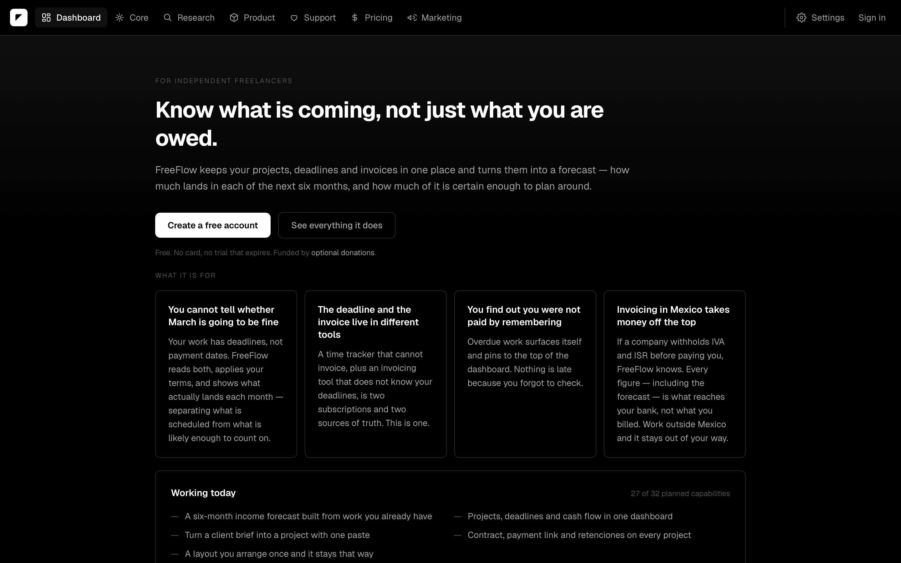

**2. `/marketing`: persona and brand**

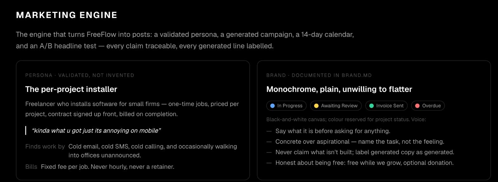

**3. Posts after "Generate live", labelled AI-generated**

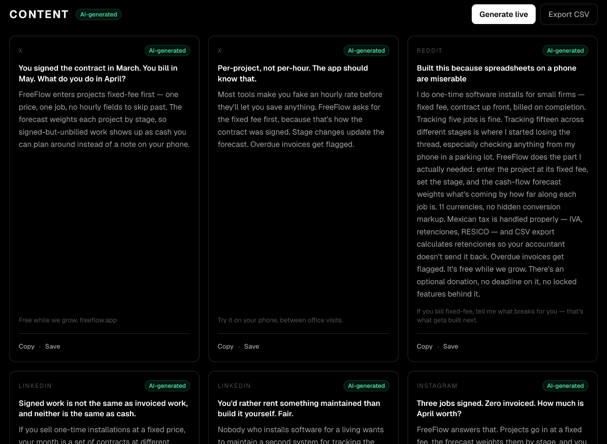

**4. The three video scripts**

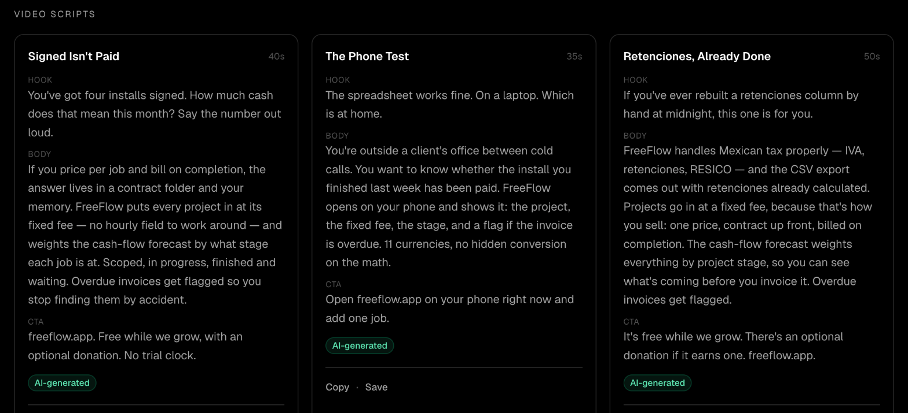

**5. Copy and Export CSV**

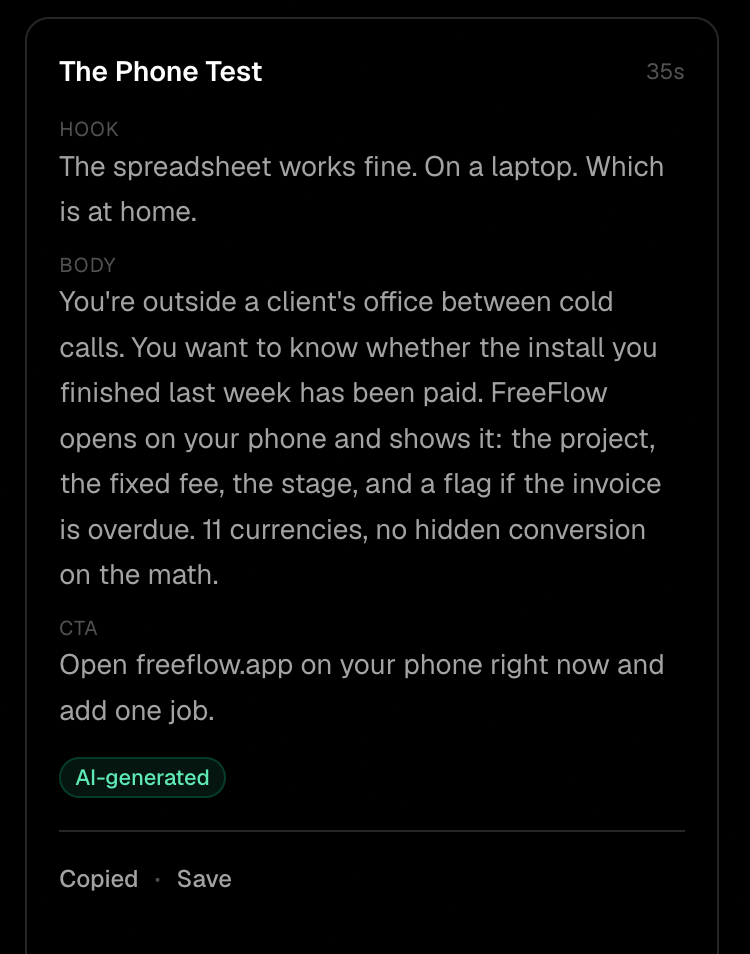

**6. The 14-day campaign calendar**

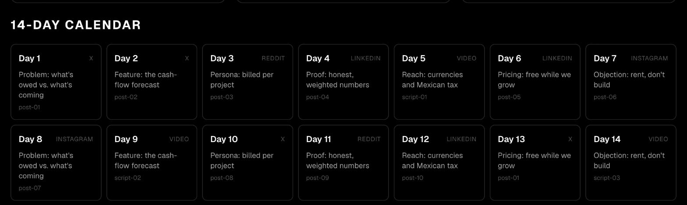

**7. A/B headline test with winners chosen**

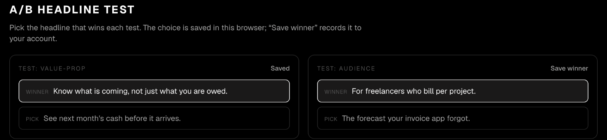

**8. Saved to your account, after a reload**

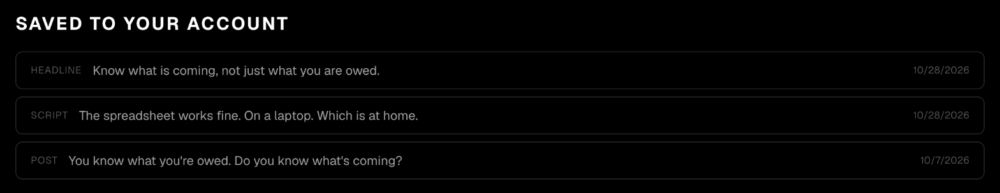

**9. Supabase: the `marketing_assets` table**

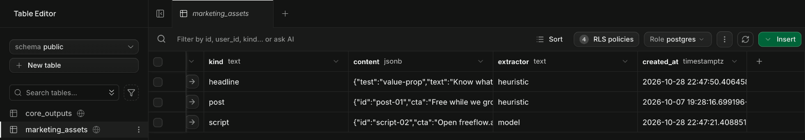

**10. Supabase: per-user RLS policies**

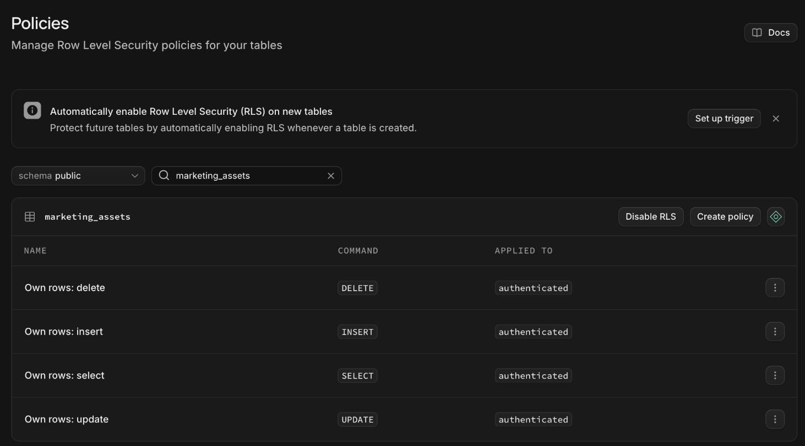

**11. `npm run test:marketing`: 22 passed**

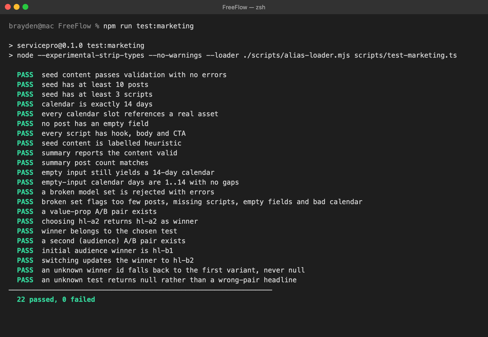

**12. GitHub commits and Vercel deployments**

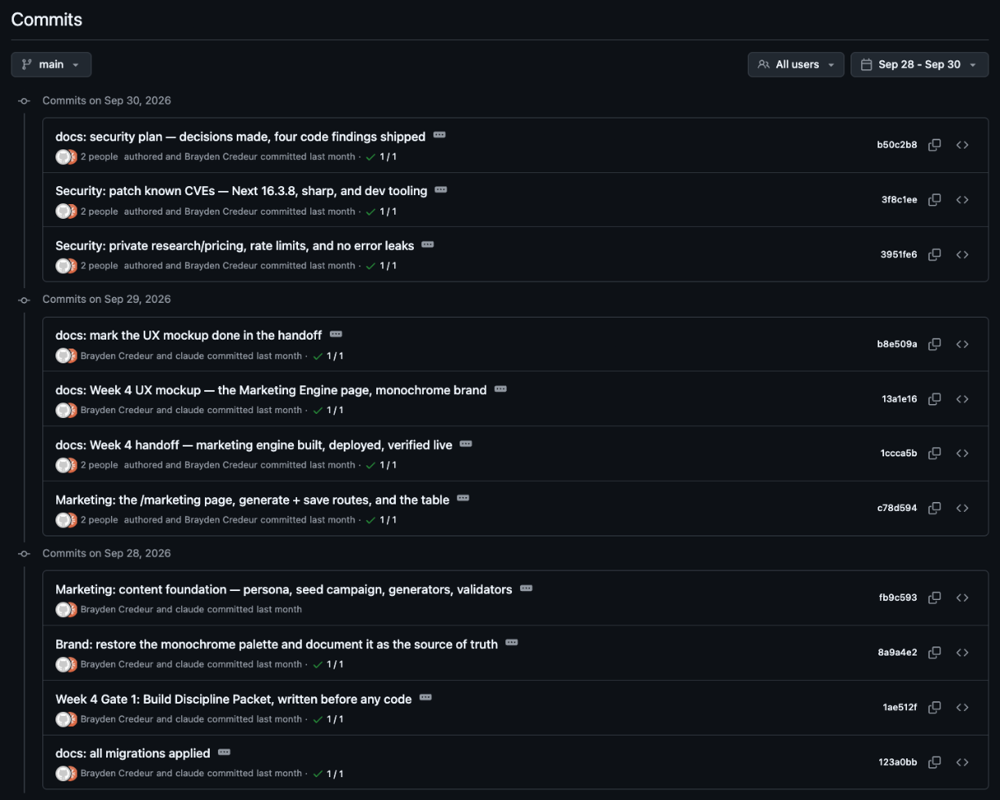

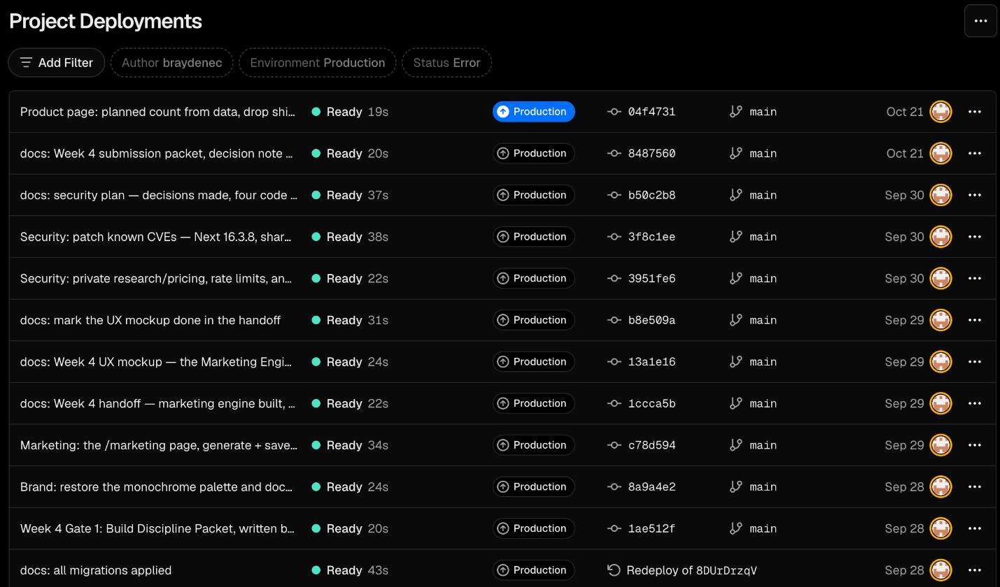
