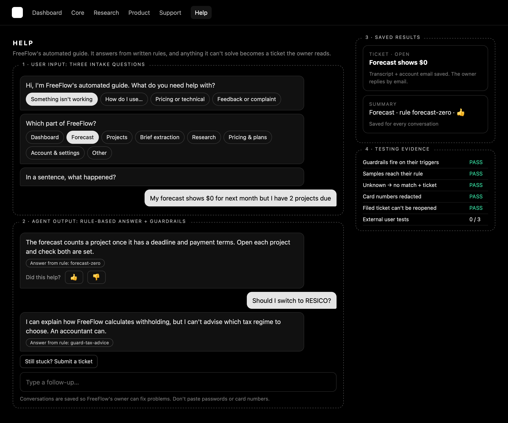

# Week 5: Public Chatbot / Guided Assistant (Build Discipline Packet)

**Gate 1. Committed before any Week 5 code is written.** Ordered to the course
macro-prompt output format. Design source: `docs/superpowers/specs/2026-10-28-chat-design.md`.

**Required live page:** `/chat` · **Grade caps:** no live page means max 5/10;
no packet means max 6/10; written work with no code means max 5/10.

> **Decisions taken up front (2026-10-28, with Brayden):**
> 1. `/chat` is a **help desk for existing users**, not a sales bot. People
>    open it when something isn't working, when a feature isn't clear, or with
>    a pricing or technical question. Important conversations (bugs,
>    complaints) are saved.
> 2. **No AI at runtime.** Answers come from a rule-based engine whose rules
>    are designed in conversation between Brayden and the coding agent. This
>    satisfies "no paid APIs required", and every answer is labelled with the
>    rule that produced it.
> 3. **Signed-in users only**, to reduce load. `/chat` still loads for
>    everyone; signed-out visitors see a sign-in prompt.
> 4. **Human checkpoint = tickets.** When the bot can't help, the user files a
>    ticket. Brayden reads it in Supabase, fixes the problem and emails the
>    person himself.
> 5. **The bot is trained by testing it together.** Every wrong answer becomes
>    a test case and a rule fix, recorded in the iteration log.

---

## What already exists (the plan leans on it rather than reinventing)

| Need | Already present | Location |
|---|---|---|
| The facts the bot answers from | Feature map, built vs planned | `lib/product/features.ts` |
| Pricing and donation facts | Free while it grows, optional donations | `lib/support.ts`, `lib/pricing/` |
| Auth on the server | `getServerSupabase`, `getSessionUser` | `lib/supabase/server.ts` |
| Rate limiting | Sliding window, no dependency | `lib/ratelimit.ts` |
| Save-route pattern | Auth first, zod, generic errors | `app/api/marketing/save/route.ts` |
| Per-user table pattern | Four own-row RLS policies | `supabase/marketing_assets.sql` |
| Test runner | `node --experimental-strip-types` suites | `scripts/test-*.ts` |
| Brand | Monochrome, voice rules | `docs/week4/BRAND.md` |

New engineering: the rule engine, one table, one route, one page, and a nav link.

---

## 1. Problem: what user problem is this solving?

When something in FreeFlow doesn't work, a user has nowhere to go. They can't
tell whether it's a bug or a misunderstanding, there's no workaround on offer,
and the owner never hears about it. Questions about how a feature works or what
FreeFlow costs go unanswered too. Every unreported problem is a user who
quietly leaves, and a bug that never gets fixed.

## 2. User: who will use it?

| User | Need |
|---|---|
| A long-term FreeFlow user (the per-project installer from the Week 2 interview) | Get unstuck fast, on a phone, without writing an email |
| Brayden, the owner | A record of what breaks, complaints in one place, and a way to reply to the person |

## 3. Success: what must work by the end of the week?

A signed-in user opens `/chat`, answers three quick questions, and either gets
a correct answer (labelled with its rule and rateable) or files a ticket in
under a minute. The bot refuses the nine things it must never do. Every
conversation leaves a summary in Supabase, important ones leave the full
transcript, and tickets can't be changed by the user once filed. The live page
loads, and at least 3 software tests and the owner training sessions pass.
The 3 external user tests are added when testers are available.

## 4. UX concept: mockup + implementation note



*Guided chat, chosen by Brayden over a form-first layout. The four zones the
course image prompt asks for are labelled: user input, agent output, saved
results and testing evidence. Source: `docs/week5/mockup.html`.*

**Implementation note.** One column, chat bubbles in the existing monochrome
system. The first two intake questions are tap buttons (fast on a phone), the
third is typed. Each bot answer shows "Answer from rule: …" and 👍/👎. "Still
stuck? Submit a ticket" appears after the first answer. A permanent notice says
conversations are saved and warns against pasting passwords or card numbers.

## 5. Scope cut: what looked nice but will not be built this week?

- An AI model writing answers
- Chat for signed-out visitors
- A private ticket-review page inside FreeFlow (Brayden uses the Supabase table)
- Email notifications (Brayden emails people by hand)
- Automatic deletion of old conversations
- Languages other than English

## 6. Product spec: requirements and acceptance criteria

| # | Requirement | Acceptance criterion |
|---|---|---|
| A1 | `/chat` page | Returns 200 signed out (sign-in prompt) and signed in (chat) |
| A2 | Chat UI | Bubbles for user and bot; usable at 375px with no horizontal scroll |
| A3 | 3 intake questions | Category (4 buttons), area (9 buttons), then a typed sentence, in that order |
| A4 | Response logic | Each answer comes from a named rule shown under it; unknown questions get an honest "no answer yet" |
| A5 | Guardrail response | Each guardrail below fires on its triggers, tested |
| A6 | Human checkpoint | "Submit a ticket" files a ticket with the transcript and account email; filed copy "Filed. The owner reads every ticket and will email you." |
| A7 | Chat/test storage | Every conversation saves a summary row; tickets, 👎, no-match and guardrail chats save the full transcript |
| A8 | Rating | 👍/👎 per answer, saved with the rule id |
| A9 | Ticket integrity | A user can't change or reopen a filed ticket (route 409 and RLS) |
| A10 | Privacy | Card numbers, keys and passwords are replaced with `[removed]` before display and before saving |
| A11 | Save test summary | The summary row records category, area, rules fired, ratings, outcome |
| A12 | 3 external user tests | Three people outside the project each complete a conversation; their rows are the evidence (added later) |

**Guardrails (each one an acceptance criterion):** the bot never (G1) claims a
feature that isn't built; (G2) says an issue is fixed or promises a date; (G3)
passes itself off as a person; (G4) gives tax or legal advice; (G5) invents
prices; (G6) asks for or stores passwords, card numbers or keys; (G7) discusses
another person's account; (G8) claims to have changed the user's account; (G9)
blames the user or ends at a dead end. Off-topic messages get a polite
one-liner.

## 7. Architecture: frontend, backend, database, data flow

```
Browser (/chat, ChatWindow)
  │ intake: category, area, sentence
  │ runs lib/chat engine locally → shows answer + rule id
  │ POST /api/chat/session { id, category, area, messages[], ratings[], fileTicket }
  ▼
/api/chat/session (server)
  rate limit → auth (401) → zod → replay messages through the SAME engine
  → outcome + rules fired computed, not trusted → 409 if a ticket exists
  ▼
Supabase: chat_sessions (RLS own rows; filed tickets frozen)
  ▲
Brayden reads tickets in the dashboard, emails the user, sets "resolved"
```

`lib/chat/` is pure (no React, no I/O): `types`, `redact`, `guards`, `rules`,
`engine`, `session`, `samples`, `schema`.

## 8. Tech stack

| Tool | Why |
|---|---|
| Next.js 16.3.8 App Router, React 19 | The existing app |
| Tailwind v4 | Existing styling and brand tokens |
| Supabase + RLS | Existing auth and database; the table follows the Week 4 pattern |
| zod | Already installed; validates the save payload |
| A rule engine written in TypeScript | Free, deterministic, can't invent answers |
| Node strip-types test runner | The project's existing test setup |

## 9. DevOps

Work on branch `week5-chat`; Vercel builds a preview per push and production
deploys from `main` after merge. Brayden runs `supabase/chat_sessions.sql` in
the SQL Editor. It never drops the table, so re-running it is safe. No new
environment variables.

## 10. Test plan

- **Software tests (`npm run test:chat`):** redaction keeps ordinary numbers;
  each guardrail fires; sample questions reach their rule; unknown is
  no-match with a ticket offer; rule integrity (unique ids, real links,
  planned features say "not built"); session outcome and ticket-freeze logic;
  payload bounds.
- **Live checks:** `/chat` 200; signed-out save 401; a real conversation
  creates a row; double ticket gives 409.
- **Owner training sessions:** wrong answers become samples, then rule fixes,
  logged.
- **3 external user tests:** later, recorded with their session rows.

## Coding-agent implementation prompt

> Implement `docs/superpowers/plans/2026-10-29-chat-help-assistant.md`
> task by task against the spec `docs/superpowers/specs/2026-10-28-chat-design.md`.
> Test first for every task, keep `npm test` green, add no dependencies, use no
> AI at runtime, and build only the agreed scope above.

## Actions only Brayden can take

1. Run `supabase/chat_sessions.sql` in the Supabase SQL Editor.
2. Approve the merge of `week5-chat` into `main` for production.
3. Test the bot with the agent and agree the right answers.
4. Find 3 external testers.
5. Record the 2–3 minute demo and rewrite the decision note in his own words.
