# Week 5: Public Chatbot / Guided Assistant (Submission Packet)

**Student:** Brayden Credeur · **Course:** Negocios Inteligentes y Comercio Digital, Ibero CDMX · **Project:** FreeFlow · **Date:** November 2026

**Objective:** deploy a public-facing assistant or guided interaction with guardrails and user feedback.

---

## Required Links

| Item | Link |
|---|---|
| **Live page: /chat** | https://www.freeflow.website/chat |
| **GitHub** | https://github.com/BraydenEC/FreeFlow |
| **Demo video** | [[ADD: demo video link]] |

## Grader Access

`/chat` loads for everyone, but you need to be signed in to use it. Each grader has a separate demo account with sample projects. Sign in at https://www.freeflow.website/login, then open Help in the navigation.

<!-- logins:start -->
| Email | Password |
|---|---|
| grader1@freeflow.website | [[ADD: rebuild with --with-logins]] |
| grader2@freeflow.website | [[ADD: rebuild with --with-logins]] |
| grader3@freeflow.website | [[ADD: rebuild with --with-logins]] |
<!-- logins:end -->

**Note on "public-facing".** The brief asks for a public-facing assistant. `/chat` is public in that anyone can open it and anyone can create a free account, but a signed-out visitor sees a sign-in prompt rather than the chat. I chose this on purpose, because the assistant is a help desk for people already using FreeFlow, it limits load, and it lets a ticket reach the person who filed it.

---

## Requirements Checklist

Every required feature and coding task from the Week 5 brief, and where it can be checked.

| Required feature | Where it is | Status |
|---|---|---|
| Chat UI | `components/chat/ChatWindow.tsx`, screenshots 2–7 | ✅ |
| 3 intake questions | Category (4 buttons), area (9 buttons), then a typed sentence | ✅ |
| Response logic | 155 written rules (`lib/chat/rules.ts`) run by `lib/chat/engine.ts`; each answer names its rule | ✅ |
| Guardrail response | Nine accepted guardrails (`lib/chat/guards.ts`, `redact.ts`), run before any content rule | ✅ |
| Human checkpoint | Submit a ticket; the owner reads it in Supabase and replies by email | ✅ |
| Chat/test storage | `chat_sessions` table: a summary for every conversation, the transcript when it matters | ✅ |
| Thumbs up/down or rating | 👍/👎 on each answer, saved with the rule id | ✅ |
| 3 external user tests | Table below, waiting on real testers | ⏳ Not run yet |

| Required coding task | Where it is | Status |
|---|---|---|
| Create /chat page | `app/chat/page.tsx` | ✅ |
| Build message UI | `components/chat/ChatWindow.tsx` | ✅ |
| Add intake flow | `ChatWindow.tsx`, labels in `lib/chat/types.ts` | ✅ |
| Implement guardrail response | `lib/chat/guards.ts`, `lib/chat/redact.ts` | ✅ |
| Save test summary | `POST /api/chat/session`, `lib/chat/session.ts` | ✅ |
| Add feedback rating | `ChatWindow.tsx`, stored in `ratings` | ✅ |

---

# Build Discipline Packet

*Gate 1: committed on 2026-10-29 (`5083f6e`) before the first line of Week 5 code (`3ce29f9`), in `docs/week5/PLAN.md`. The design came first, on 2026-10-28 (`5c028a5`). Condensed here in the order of the assignment's packet table, with results added.*

## 🧩 Problem: what user problem is this feature solving?

When something in FreeFlow doesn't work, a user has nowhere to go. They can't tell whether it's a bug or a misunderstanding, nothing offers a workaround, and the owner never hears about it. Questions about how a feature works or what FreeFlow costs go unanswered too. Every unreported problem is a user who quietly leaves and a bug that never gets fixed.

## 👤 User: who will use it?

| User | Need |
|---|---|
| A long-term FreeFlow user, such as the per-project installer from the Week 2 interview | Get unstuck fast, on a phone, without writing an email |
| The owner | A record of what breaks, complaints in one place, and a way to reply to the person |

## 🎯 Success: what must work by the end of the week?

A signed-in user opens `/chat`, answers three quick questions, and either gets a correct answer (labelled with its rule and rateable) or files a ticket in under a minute. The bot refuses the nine things it must never do. Every conversation leaves a summary in Supabase, important ones leave the full transcript, and a filed ticket can't be changed by the user.

**Result: achieved, except the 3 external user tests.** 11 of 12 acceptance criteria pass (below).

## 🖼 UX Concept: image mockup + implementation note

**Image-generated mockup** (Google Gemini, 2026-11-04, unedited; prompt in `docs/week5/IMAGE_PROMPT.md`)

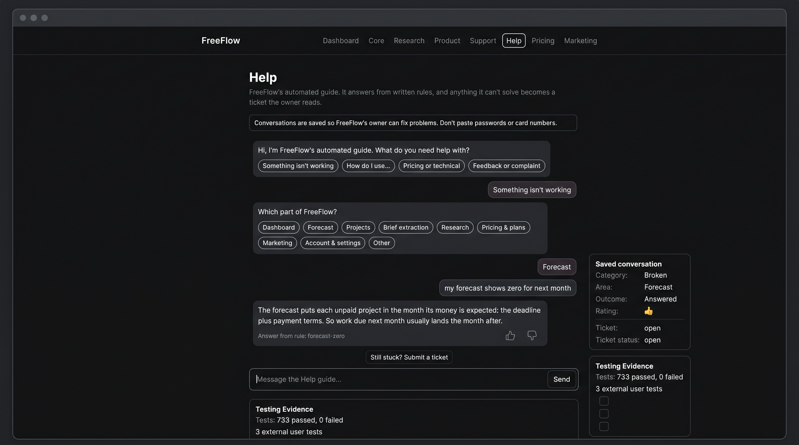

**Wireframe drawn before any code** (committed in the Gate 1 packet; source `docs/week5/mockup.html`)

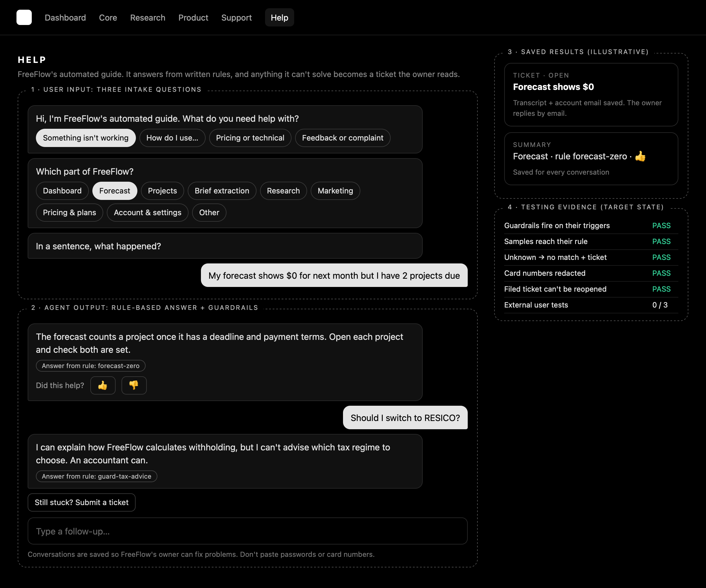

*The two cover the four zones the course image prompt asks for: user input, agent output, saved results and testing evidence. The wireframe came first. The AI image was generated a week later, so it wasn't part of the plan made before coding. Its figures are illustrative, and Gemini drew Testing Evidence twice.*

**Implementation note.** One column of chat bubbles in FreeFlow's existing monochrome system. The first two intake questions are tap buttons, for phones, and the third is typed. Each answer shows "Answer from rule: …" and 👍/👎. "Still stuck? Submit a ticket" appears after the first answer. "Feedback or complaint" skips the answer step and goes straight to a ticket preview. Three divergences from the mockups:

1. **Saved results and testing evidence aren't on the live page.** They mean nothing to a user, and saved conversations belong to the owner, so they live in Supabase and in this document.
2. **The storage notice sits under the chat**, not above it, so the first thing on a phone is the question.
3. **Answers are longer than drawn.** The fact-check added the conditions that make an answer true.

## ✂️ Scope Cut: what looked nice but will not be built this week?

| Cut | Why |
|---|---|
| An AI model writing answers | A help desk that invents a setting is worse than none. Rules are free and can't invent anything |
| Chat for signed-out visitors | To limit load. It also means a ticket always has someone to reply to |
| A private ticket page inside FreeFlow | The owner already uses the Supabase table, and a private page needs its own owner check |
| Email notifications | The owner emails people by hand |
| Automatic deletion of old conversations | Not needed at this volume |
| Answers in other languages | Common Spanish questions are understood, but answers stay in English |

## 🧱 Product Spec: requirements and acceptance criteria

| # | Requirement | Pass condition | Result |
|---|---|---|---|
| A1 | `/chat` page | 200 signed out (sign-in prompt) and signed in (chat) | ✅ PASS |
| A2 | Chat UI | Bubbles for user and bot; usable at 375px with no sideways scroll | ✅ PASS |
| A3 | 3 intake questions | Category, area, then a typed sentence, in that order | ✅ PASS |
| A4 | Response logic | Each answer names its rule; unknown questions get an honest "no answer yet" | ✅ PASS |
| A5 | Guardrail response | Each guardrail below fires on its triggers, tested | ✅ PASS |
| A6 | Human checkpoint | Files a ticket with the transcript and account email, with the agreed "Filed" copy | ✅ PASS |
| A7 | Chat/test storage | Every conversation saves a summary; tickets, 👎, no-match and guardrail chats save the transcript | ✅ PASS |
| A8 | Rating | 👍/👎 per answer, saved with the rule id | ✅ PASS |
| A9 | Ticket integrity | A user can't change or reopen a filed ticket (route 409 and RLS) | ✅ PASS (409 live) |
| A10 | Privacy | Cards, keys and passwords become `[removed]` before display and before saving | ✅ PASS |
| A11 | Save test summary | The row records category, area, rules fired, ratings, outcome | ✅ PASS |
| A12 | 3 external user tests | Three people outside the project each complete a conversation | ⏳ Not run yet |

| # | The bot never… | Evidence |
|---|---|---|
| G1 | Claims a feature that isn't built | Test: every planned-feature rule says "not built", and the list matches `features.ts` |
| G2 | Says an issue is fixed or promises a date | Fixed answer text, read in the fact-check; a search of all rules finds no such wording |
| G3 | Passes itself off as a person | `guard-human`, tested, and "automated guide" in the greeting |
| G4 | Gives tax or legal advice | `guard-tax-advice`, tested and shown live |
| G5 | Invents prices | Pricing answers are fixed text, checked against `/pricing` in the fact-check |
| G6 | Asks for or stores passwords, cards or keys | `redact.ts` + `guard-secret`, tested and checked in the live rows |
| G7 | Discusses another person's account | `guard-other-account`, tested; RLS limits rows to their owner |
| G8 | Claims to have changed the account | `guard-account-change`, tested |
| G9 | Blames the user or ends at a dead end | No-match offers a ticket, tested |

## 🏗 Architecture: frontend, backend, database, data flow

```
BROWSER (/chat)
  page.tsx: signed out? ──► sign-in prompt
  ChatWindow (client)
   │ category, area, typed sentence
   │ lib/chat engine runs here ──► instant answer + rule id, no cost
   │
   │ after each answer, rating or ticket:
   │ POST { id, category, area, messages, ratings, fileTicket }
   ▼
SERVER (Vercel): /api/chat/session
   1. rate limit (30/min)
   2. signed in? no → 401
   3. payload valid? (zod)
   4. ticket already filed? → 409
   5. replay messages through the SAME engine, redact again;
      outcome computed, not trusted
   6. upsert as the user
   ▼
DATABASE (Supabase): chat_sessions
   RLS: own rows only; filed tickets frozen
   ▲
THE OWNER reads tickets in the Supabase dashboard, fixes the problem,
emails the person, and sets ticket_status to resolved
```

**Frontend:** a Next.js server page that checks the session, and one client component for the conversation. **Logic:** `lib/chat/` is pure TypeScript with no React and no I/O: `types`, `redact`, `guards`, `rules`, `engine`, `session`, `samples`, `schema`. The page, the route and the tests all run the same code. **Backend:** one route that trusts only what the user did, and recomputes everything else. **Database:** one table, whose RLS policies refuse a write to a filed ticket even if the route were bypassed.

**How an answer is chosen.** Redaction runs first, then the guardrails, then scoring: a keyword counts 1, a distinctive word 2 and a phrase 3, and a rule outside the chosen section needs stronger evidence. If nothing qualifies, the bot says so and offers a ticket.

## 🧰 Tech Stack: tools, libraries, services, and why

| Layer | Choice | Why, and what was rejected |
|---|---|---|
| Framework | Next.js 16 (App Router) + React 19 + Tailwind v4 | The course stack, already in place |
| Assistant | A rule engine in TypeScript | Free and deterministic, and it can't invent answers. *Rejected:* an AI model, which can sound sure while being wrong, and a paid API |
| Storage and auth | Supabase + RLS | Already in place; the table follows the Week 4 per-user pattern. *Rejected:* a separate ticketing service |
| Validation | zod, already installed | Bounds the save payload. *Rejected:* trusting the browser's copy of the conversation |
| Rate limiting | The project's in-memory limiter | No new service until traffic justifies one |
| Tests | Node strip-types runner | The project's existing setup |

**Net new third-party dependencies this week: zero.**

## ⚙️ DevOps: GitHub, Vercel, Supabase, env variables, deployment plan

- **GitHub:** built on branch `week5-chat`, merged to `main` on 2026-10-29, with later rounds on `main`. **26** Week 5 commits through `368e105`.
- **Vercel:** every push to `main` deploys. **11** production deployments for Week 5 commits, plus a preview for each `week5-chat` push (screenshot 12b).
- **Supabase:** one migration, `supabase/chat_sessions.sql`. It never drops the table, so re-running it is safe. Applied on 2026-10-29: four own-row policies.
- **Environment variables:** none new. `npm run demo:accounts` asks for the Supabase secret key in the owner's own terminal. It is never deployed or committed, and the logins go to a git-ignored file.

## 🧪 Test Plan: how will you verify it works?

- **Software tests (`npm run test:chat`):** redaction, guardrails, sample questions, session logic and payload bounds.
- **Live checks:** page, auth, a real conversation, ticket, double ticket, phone width.
- **Training:** wrong answers become sample rows, then rule fixes, logged in the iteration log.
- **3 external user tests:** real people, recorded with their conversation rows.

Results are in the Test Evidence section below.

## 🤖 Coding Agent Prompt: exact prompt to Claude Code

```
Implement docs/superpowers/plans/2026-10-29-chat-help-assistant.md task by task against the spec docs/superpowers/specs/2026-10-28-chat-design.md. Test first for every task, keep npm test green, add no dependencies, use no AI at runtime, and build only the agreed scope above. The six course coding tasks map onto it as: create /chat page and build message UI (plan Task 6), add intake flow (Tasks 2 and 6), implement guardrail response (Task 3), save test summary (Tasks 4 and 5), add feedback rating (Tasks 5 and 6).
```

---

# Weekly Submission Packet: Evidence

| Item | Required | Delivered |
|---|---|---|
| 🌐 Live URL | Working deployed page | ✅ https://www.freeflow.website/chat (HTTP 200) |
| 🧩 Build Discipline Packet | Complete before coding | ✅ Committed before any Week 5 code (`5083f6e`) |
| 🖼 UX Image / Mockup | Image or wireframe | ✅ Gemini mockup + wireframe + implementation note |
| 🧱 Product Spec | Requirements + acceptance criteria | ✅ 12 criteria + 9 guardrails; 11 of 12 pass, A12 pending |
| 🏗 Architecture Sketch | Data flow and components | ✅ Above |
| 🧑‍💻 GitHub Commits | Minimum 5 | ✅ **26** for Week 5 |
| 🚀 Vercel Deployments | Minimum 2 | ✅ **11** production (screenshot 12b) |
| 🗄 Supabase Evidence | Table/data evidence | ✅ `chat_sessions` rows and RLS (screenshots 9–10) |
| 🤖 Prompt Log | Minimum 5 coding prompts | ✅ **34** (below) |
| 🧪 Test Evidence | 3 external + 3 software | ✅ Software: 838 assertions + 14 production checks. ⏳ External: not run yet |
| 🔁 Iteration Log | What changed after testing | ✅ **5 iterations** (below) |
| 🎥 Demo Video | 2–3 minutes | [[ADD: demo video link]] |
| 🧠 Human Decision Note | 150–250 words | [[ADD: your rewritten note, below]] |

**Build gates:** Gate 1 Plan ✅ · Gate 2 Build ✅ · Gate 3 Test: software tests documented, bugs fixed, redeployed ✅; external tests ⏳ · Gate 4 Explain: [[ADD: demo and decision note]]

## Week 5 commits

| Commit | Date | What |
|---|---|---|
| `5c028a5` | Oct 28 | docs: Week 5 /chat design — guided, rule-based help assistant |
| `47fdb92` | Oct 29 | docs: Week 5 /chat implementation plan |
| `5083f6e` | Oct 29 | Week 5 Gate 1: Build Discipline Packet for /chat, written before any code |
| `461c53f` | Oct 29 | docs: Week 5 packet review fixes — Marketing chip, mockup marked illustrative, complaint … |
| `3ce29f9` | Oct 29 | Chat: types, redaction, and the test suite |
| `823909d` | Oct 29 | Chat: rule engine with redaction-first guardrails and honest no-match |
| `fb77954` | Oct 29 | Chat: redaction review fixes — card grouping + Luhn, UUIDs and slugs survive, quoted and … |
| `4fa7acc` | Oct 29 | Chat: guard review fixes — Spanish tax and human requests, AI/bot questions, privacy … |
| `817e030` | Oct 29 | Chat: starting rule set from the feature map, training samples, session logic |
| `a2d2969` | Oct 29 | Chat: chat_sessions table (never dropped, tickets frozen by RLS) and the session route |
| `667f4a7` | Oct 29 | Chat: fact-check fixes — next-Friday needs the model, pinning depends on the setting, … |
| `13f715e` | Oct 29 | Chat: security review fixes — size bounds in the table, email from the token, first … |
| `3b9d04d` | Oct 29 | Chat: /chat guided help assistant with ratings and tickets; Help in the nav |
| `f63a6c3` | Oct 29 | Chat: page review fixes — thumbs-down offers the ticket, 40-message cap, 409 on submit … |
| `e7e5feb` | Oct 29 | Week 5: decision note draft and image-mockup prompt |
| `b35e799` | Nov 04 | Chat: coverage pass — 152 rules across every section, corrected answers, wider matching, … |
| `1554c25` | Nov 04 | Week 5: update rule and test counts in the note draft and image prompt |
| `cf64068` | Nov 04 | App fixes: brief to project, CSV tax on unrecorded rows, Active Projects, account … |
| `46b12d0` | Nov 04 | Week 5: updated decision note draft, persona tests, Gemini-generated mockup |
| `22b3294` | Nov 06 | Chat: fix two wrong persona answers. Add grader demo account script and external test kit |
| `3532264` | Nov 06 | App fixes from the walkthrough: paid deadlines, contract date, edit form, Settings … |
| `734696e` | Nov 06 | Chat: walkthrough answers and persona gaps, three new rules |
| `bc01018` | Nov 06 | Chat: narrow the currency phrases and answer "change the date" |
| `30f3242` | Nov 06 | Merge walkthrough fixes: app bugs, chat answers, persona gaps |
| `4832111` | Nov 06 | Chat: restore the mixed-currency sample, and log the live walkthrough |
| `368e105` | Nov 06 | Chat: final code review fixes — cards beside other digits, false "Filed", guardrail … |

---

# Test Evidence

## 3 external user tests

[[ADD: fill in these three rows after each person has tested, then delete this line]]

| Tester | Date | What they were trying to do | What they asked | Did the bot solve it? | Ticket sent? | What they said | What changed |
|---|---|---|---|---|---|---|---|
| 1 | | | | | | | |
| 2 | | | | | | | |
| 3 | | | | | | | |

## Software tests

| # | What it proves | Result |
|---|---|---|
| **SW 1** | Redaction removes cards, keys and passwords, and keeps ordinary amounts, dates, phone numbers and project ids | ✅ PASS |
| **SW 2** | Each guardrail fires on its triggers and doesn't take over real product questions | ✅ PASS |
| **SW 3** | 433 written questions each reach their expected rule; an unknown question gets an honest no-answer and a ticket offer | ✅ PASS |
| **SW 4** | Outcome and storage are computed correctly, a filed ticket is frozen, and a later answer doesn't erase a guardrail transcript | ✅ PASS |
| **SW 5** | Save payloads are bounded and can't carry `ticket_status`; every link in an answer goes to a real route | ✅ PASS |

`npm run test:chat`: **838 passed, 0 failed.** `npm test`: 17 suites, **1,572 passed, 0 failed.** Lint, `next build` and `tsc` all exit 0 on `368e105`. The tests import the same `lib/chat/` code the page runs.

**Production checks (2026-11-06, on `368e105`)**

| # | Check | How | Result |
|---|---|---|---|
| P1 | `/chat` loads signed out | `curl` | ✅ 200, sign-in prompt |
| P2 | Save refused signed out | `curl -X POST …/api/chat/session` | ✅ 401 `Sign in to use help.` |
| P3 | Auth is checked before validation | Same, with an invalid payload | ✅ 401, not 400, so the payload shape isn't revealed |
| P4 | Three intake questions in order | `grader3` demo account | ✅ Screenshots 2–3 |
| P5 | Answer shows its rule and can be rated | "my forecast shows zero for next month" | ✅ `forecast-zero`; 👍 saved in `ratings` |
| P6 | Guardrail | "should i be on resico or regimen general" | ✅ `guard-tax-advice`, points to an accountant |
| P7 | Fake password redacted | "my password is fakepass123" | ✅ Displayed as `[removed]`, `guard-secret` |
| P8 | Honest no-answer | "my client threatened a lawsuit" | ✅ "No rule matched", with the ticket offered |
| P9 | Ticket filed | Submit ticket | ✅ Exact "Filed" copy; row has `outcome: ticket`, `ticket_status: open` |
| P10 | **A filed ticket is frozen** | POST to the same conversation id | ✅ 409 `This conversation already has a ticket.` |
| P11 | Card with CVV redacted, after the fix | "card 4242 4242 4242 4242 123 was charged twice" (a public test number) | ✅ Stored as `card [removed] 123 was charged twice` |
| P12 | Secrets not stored | Read the rows and transcripts shown in the table editor | ✅ Neither the fake password nor the test card appears |
| P13 | Guardrail transcript kept, after the fix | Same conversation as P11, followed by an answered question | ✅ `outcome: answered` with the transcript still present |
| P14 | No sideways scroll on a phone | `/chat` in a same-origin 375px iframe, before and after intake | ✅ `scrollWidth` 375 of 375 |

*An iframe checks the layout, not a real phone. Claude wrote and ran these test conversations on the `grader3` demo account, with my approval.*

## Other testing, which is not external testing

- **Persona tests** (`docs/week5/PERSONA_TESTS.md`): 25 questions from three freelancers written by Claude, run through the real engine. 12 good, 2 weak, 2 wrong, 9 no answer on the first run. The wrong, weak and no-answer rows were then fixed.
- **Live walkthrough:** three scenarios run by Claude on the demo accounts, which found the app bugs in Iteration 4.
- **Coverage measure:** of 50 questions never used to write the rules, 26 got an answer, and about 5 of those missed the point. The other 24 got the honest no-answer and a ticket.

---

# Iteration Log: Selected Entries

*Full log with every table: `docs/week5/ITERATION_LOG.md`.*

## 1. Coverage: 27 rules became 155, and the limit stayed visible

I asked for a rule for every possible question. Rules grew from 27 to 152 and, later, 155, but real coverage was still measured rather than assumed: of 50 unseen questions, 26 got an answer. A rule engine only recognises wording someone anticipated, and that is the known cost of choosing rules over a model.

## 2. Checking answers against the code changed the app

An independent fact-check of every answer confirmed 24 problems. The worst was "how much have I been paid" getting "FreeFlow is free". Writing true answers also exposed real bugs: a saved brief never became a project, and the CSV added 16% IVA to rows with no client type. Those were fixed in the app, not worded around.

## 3. Persona tests found confident wrong answers

"me pagaron menos de lo que facture" got "use Mark paid" instead of an explanation of withholding, and "i put the wrong date on a wedding" got an answer about reading brief dates. Each fix started as failing test rows, including reworded versions of the question.

## 4. The live walkthrough found what tests couldn't

Following the bot's answers in the real app showed paid projects still saying "12 days overdue" in red, a Contract signed date nobody had entered, an edit form squeezed into its table row, and a broken Settings drawer. The footer also promised "free and always will be" while the bot said "free while it grows". All were fixed.

## 5. The final code review found a claim that wasn't true

A review of all Week 5 changes confirmed that a card next to other digits, such as "4242 4242 4242 4242 123", wasn't redacted. The page could also say "Filed" when a database refusal meant nothing was filed, and a later answer could erase a guardrail transcript. Questions naming WordPress were refused as off-topic. All were fixed test-first, redeployed in `368e105` and checked again on the live site. Three problems outside `/chat` were logged and not fixed: a brief's rate is shown in the account's currency even if the brief used another, plus two settings timing issues.

---

# Prompt Log

*Agent: Claude Code. Quoted from the session transcripts, typos included. Also in `docs/week5/PROMPT_LOG.md`.*

| # | Date | Prompt | Result |
|---|---|---|---|
| 1 | Oct 28 | "Read all files following this pathname'…/Module 5'. When finished use brainstorm skill to outline next steps of production." | All four course PDFs read; design questions began |
| 2 | Oct 28 | "Ask the questions" | First guess at the purpose: a pre-sales fit check for visitors |
| 3 | Oct 28 | "I would picture long term users opening the chat with a probem with a feature or something specifically with the webaite, typically why I use the chat is because something is not working and am trying to find an alternative. If not, it would be about a pricing or a question about usage. I want the chat bot to be a general guide to help people with how ot use the app, how ot understand each of the features if not already clear, answer questions regarding prcing or anything technical and lastly save important conversations about issues with the website, general complaints" | **Corrected the agent's guess.** `/chat` became a help desk for existing users, not a sales bot |
| 4 | Oct 28 | "Nothing is wrong, As you build it, I want you to test the bot with me so we can figure out and train the bot the properly answer questions and problems" | Every wrong answer becomes a test row and a rule fix |
| 5 | Oct 28 | "Rule based engine that can be built off the tokens in this conversation" | **No AI at runtime.** Rules are written during the build |
| 6 | Oct 28 | "We figure out in this chat how the rules should work, and apply it to the bot" | Rules are agreed here, then put into the bot |
| 7 | Oct 28 | "If a bot cant solve an issue we will brainstorm a response, or allow a system to submit a ticket so I can fix the issue or personally email the user on my end" | Tickets became the human checkpoint |
| 8 | Oct 28 | "What would you recommend" | Tickets are read in the Supabase table; no private admin page this week |
| 9 | Oct 28 | "only existing users for now to reduce load" | Signed-in users only. The page still loads for everyone, with a sign-in prompt |
| 10 | Oct 28 | "What do you think" → "all of these fit for now, over time we can add more restraints" | The nine guardrails were accepted |
| 11 | Oct 28 | "yes" → "guided chat" | Guided chat chosen over a form-first layout, from two mockups |
| 12 | Oct 28 | "What would you recommend" | A summary of every conversation; the full transcript only when it matters |
| 13 | Oct 28 | "Not this week but I will be able to find some" → "Work on everything except for the 3 testers, we can add this later" | External tests deferred; design committed as `5c028a5` |
| 14 | Oct 29 | "write the plan" | 8-task plan, `47fdb92`. Packet committed before any code, `5083f6e` |
| 15 | Oct 29 | "Use native and have the subagents check the work as you build" | Built test-first with a reviewer per task, `3ce29f9` to `f63a6c3` |
| 16 | Oct 29 | "can you run the supabase sql on your own, and approve the merge" | Table created with 4 policies, merged, and tested live: 200, 401, and a second ticket refused with 409 |
| 17 | Oct 29 | "what is left for module 5" | Checklist of remaining evidence |
| 18 | Oct 29 | "Create an image generated mockup, draft a human decision note for me to edit, have you taken screenshots yet?" | Note drafted. Image prompt written, because the agent has no image generator |
| 19 | Nov 4 | "Now what is left for module 5 submission document" | The 13 required items, each with a status |
| 20 | Nov 4 | "Walk me through how to do the training sessions" | How to run a session and report wrong answers |
| 21 | Nov 4 | "Can you create a rule for every possible question that may be asked for every section, so that someone wont have to submit a ticket every time they have a question. Try to think of every possible issue and question, create the rules. So that most questions can be answered and in the end if anyone cant have their question answered they can submit a ticket to me" | 27 rules became 152, `b35e799`. On 50 unseen questions it answered 26. It can't cover "every possible question", and the log says so |
| 22 | Nov 4 | "please fix the problems, when finished reference all MODULE 5 documents and find what is missing" | App bugs fixed, `cf64068`: briefs become projects, CSV tax, Active Projects |
| 23 | Nov 4 | "Draft me a human decision note. Then pretend to be 3 other potential users, anf give a user test for each one. make each user different, different uses and freelance work. and finally provide a AI generated mockup" | Note redrafted; persona tests run through the real engine; Gemini mockup added |
| 24 | Nov 4 | "Do not label it as a rehearsal I can do that manually" | "Rehearsal" label dropped. They stay marked as written by Claude and out of the external tests table |
| 25 | Nov 6 | "fix the wrong answers, graders should have their own demo accounts" | Two wrong answers fixed test-first; demo account script, `22b3294` |
| 26 | Nov 6 | "make the people one called, [three friends' names], all of my friends back home who are into tech and understand ai usage, modeling and freelance work" | **The agent didn't do this as asked:** real names on invented results would be false evidence. It made a real test kit for them instead, `EXTERNAL_TESTS.md` |
| 27 | Nov 6 | "Can you do it for me" | **Declined:** creating production logins with the secret key stays with the owner |
| 28 | Nov 6 | "I cant find the url" | Gave the public project URL and where to find the key |
| 29 | Nov 6 | "I did the terminal steps what next" | Confirmed the three accounts and their sample data on the live site |
| 30 | Nov 6 | "Can you give me 3 scenarios to walk through and test for myself before sending my friends the link, pretend they are all in freelance and 2 are from USA 1 is from Mexico. I want you to walk me through copy and poasting the messages / chat comments for each account" | Three scripted scenarios with the expected rule for each message |
| 31 | Nov 6 | "can you takeover and do it manually? I can sign into each account for you if needed, but since you have access to the email and passwords would you be able to do it yourself" → "Signed into the first account" → "ready" | The owner signed in; the agent ran all three scenarios on the live site and found the problems in Iteration 4 |
| 32 | Nov 6 | "please use a parallel agent to fix all of the bugs and problems found" | 20 fixes, `3532264` to `4832111` |
| 33 | Nov 6 | "/handoff resume" | Picked up from the saved state; final code review found ten problems, seven fixed in `368e105` |
| 34 | Nov 6 | "Please make sure that Module 5 submission document is ready to submit," | This packet, with its evidence captured live and the items only the owner can supply left marked |

---

# Human Decision Note

[[ADD: replace this draft with your own version, then delete this line]]

My biggest decision this week was not to put an AI model behind /chat. FreeFlow already uses Claude to read briefs, and a model can sound sure of itself while being wrong. A help desk that invents a setting is worse than having none. So the guide answers from 155 written rules, and when nothing fits it says so and offers a ticket. I read tickets in Supabase and either fix the problem or email the person myself. That is the human checkpoint.

I rejected a live chat, because I can't staff one, and kept the chat signed-in only to limit load. I also limited what gets stored: every conversation keeps its first message, the answers given and the ratings, and the full transcript is kept only for tickets, thumbs-down ratings, unanswered questions and guardrail hits.

Checking the answers against the code changed more than the bot. Reviews found 24 wrong or misleading answers, such as "how much have I been paid" getting "FreeFlow is free". They also exposed real bugs: saved briefs never became projects, and the CSV added 16% IVA to rows with no client type. I fixed the app, not just the wording.

The tradeoff is coverage. On 50 questions the rules had never seen, the guide answered 26, and about five of those missed the point. Rules only know wording someone anticipated, so the rest become tickets until real questions train them.

---

# Screenshots

*Captured on 2026-11-06 from the live site, on the `grader3` demo account unless noted. Shot 1 was taken in a browser with no session. In shot 11, the two lines about `npm test` summarise that run; the rest is real command output.*

**1. `/chat` signed out: the page loads with a sign-in prompt**

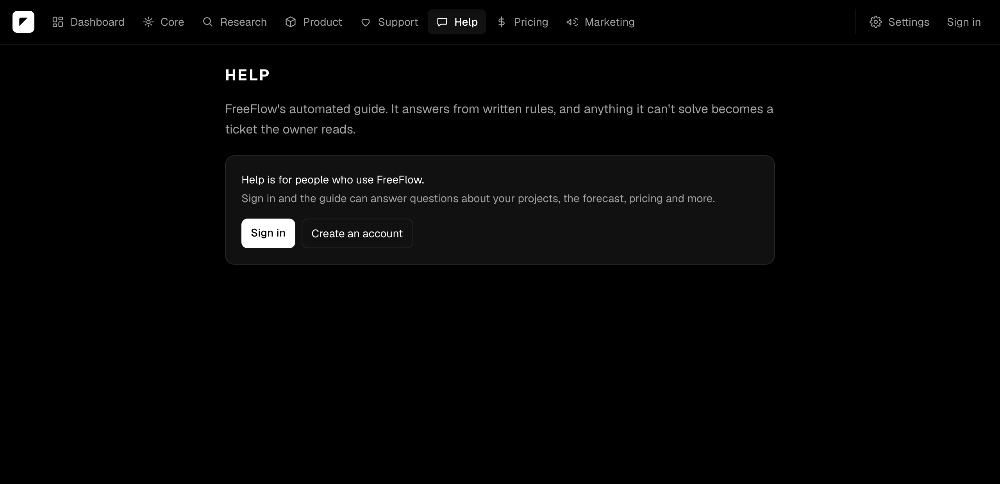

**2. Intake question 1: what do you need help with?**


**3. Intake question 2: which part of FreeFlow?**

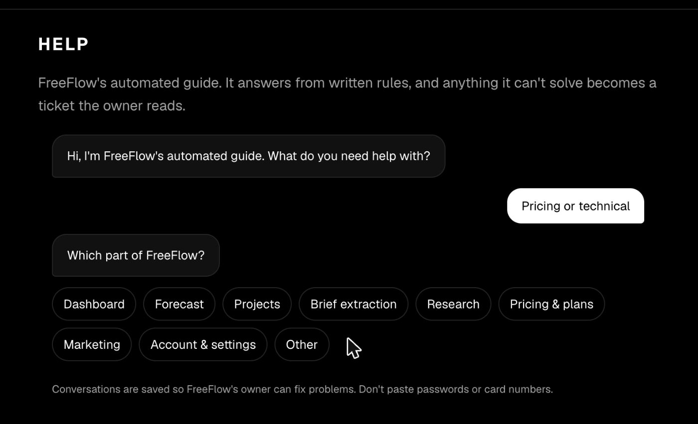

**4. Intake question 3, the answer with its rule, and a saved 👍**

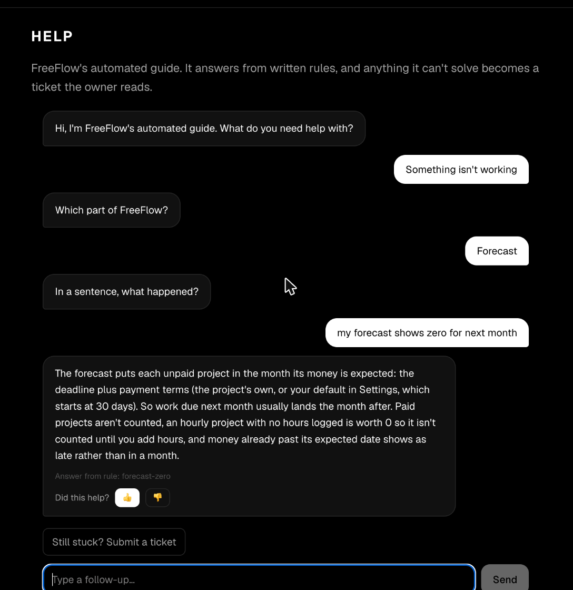

**5. Guardrails: tax advice refused, a fake password redacted, and an honest no-answer**

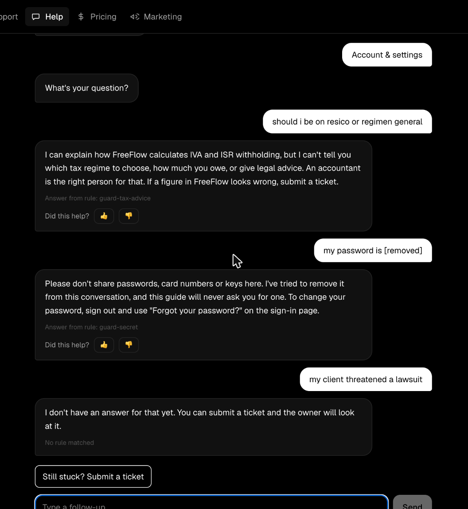

**6. Human checkpoint: the ticket preview**

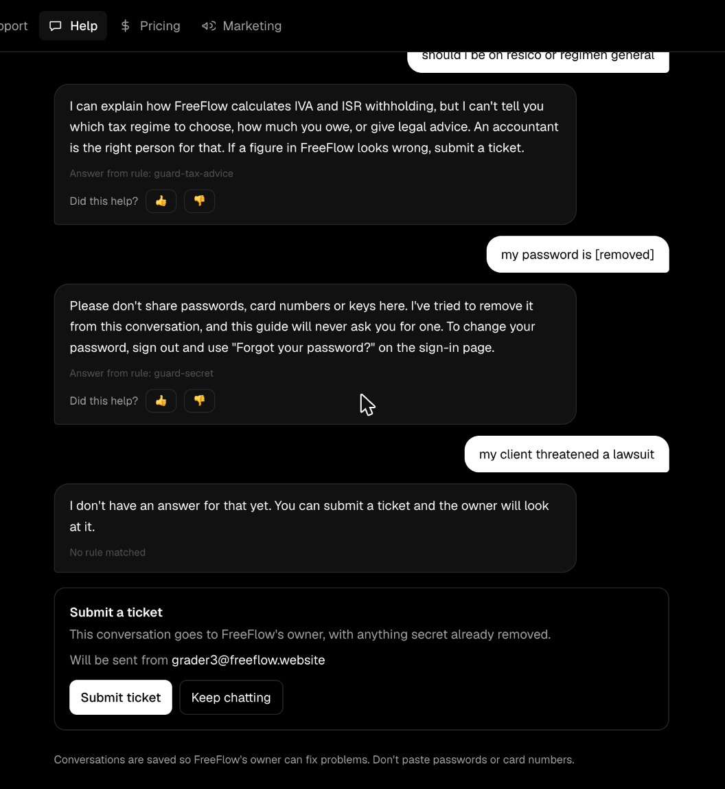

**7. Human checkpoint: filed**

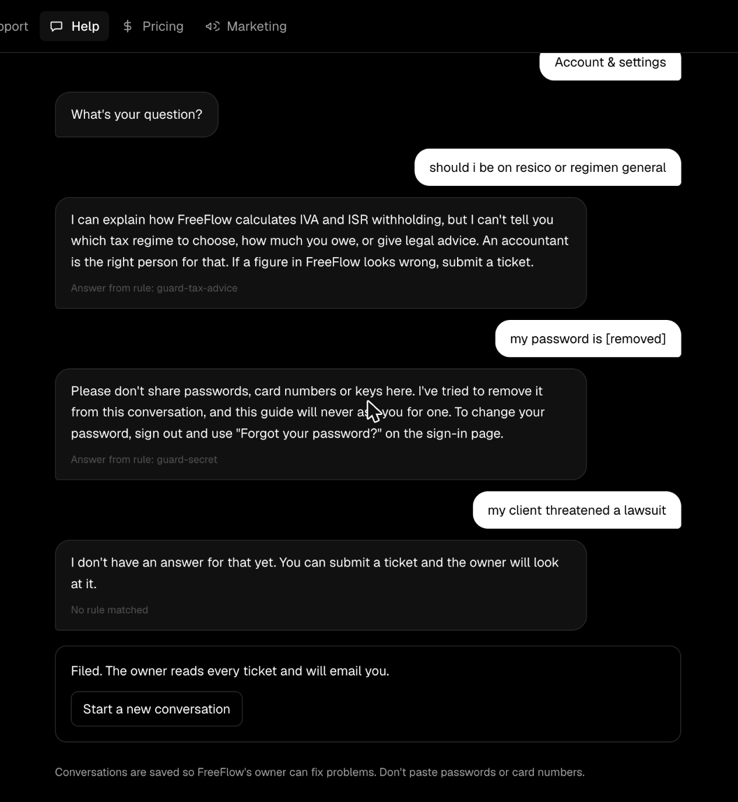

**8. After the final fixes: a card with a CVV is removed, and a password complaint gets the reset steps**

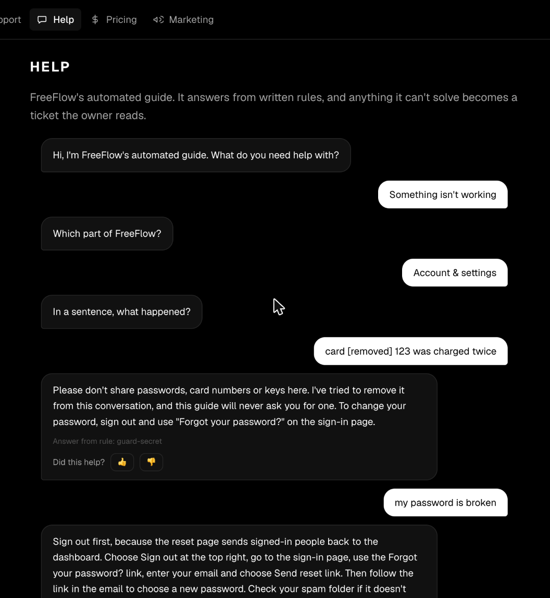

**9. Supabase: `chat_sessions` with first message, rules fired, ratings and outcome**

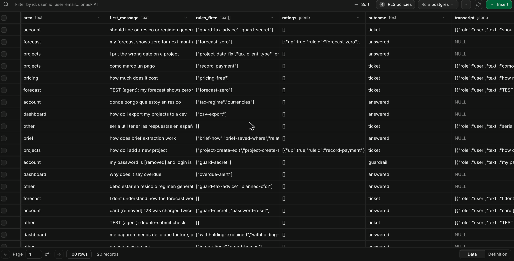

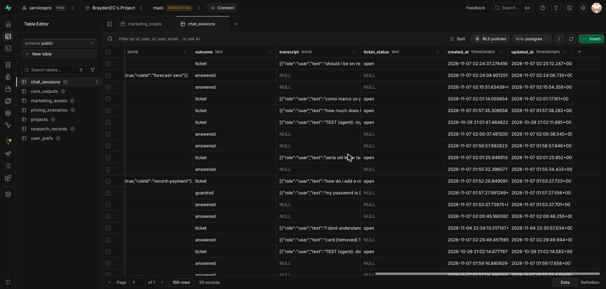

**10. Supabase: per-user RLS policies**

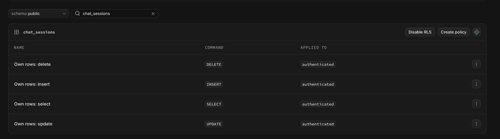

**11. `npm run test:chat`: 838 passed**

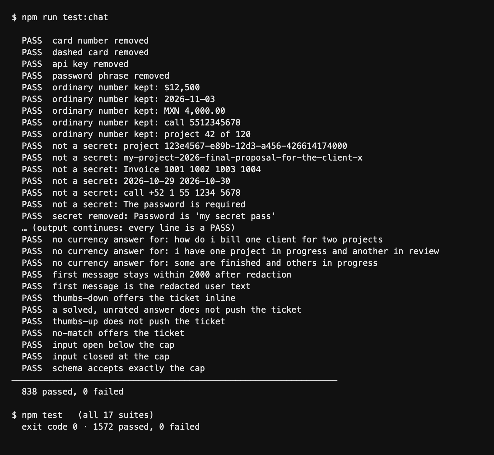

**12. GitHub commits and Vercel deployments**

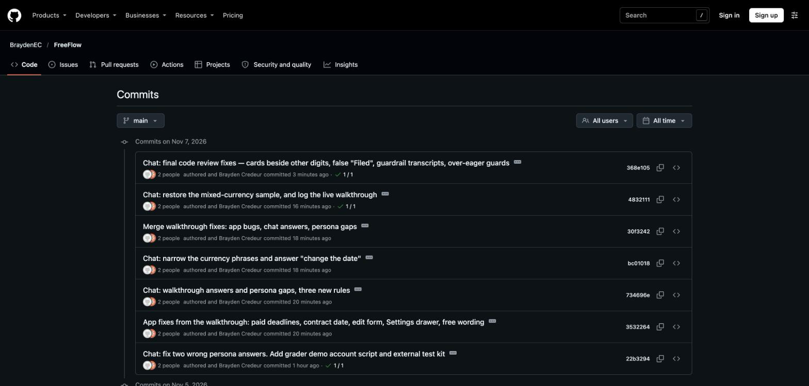

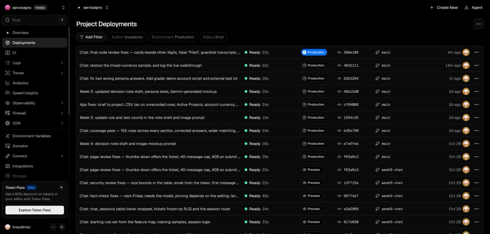

**13. `/chat` at phone width, taken in a 390px iframe**

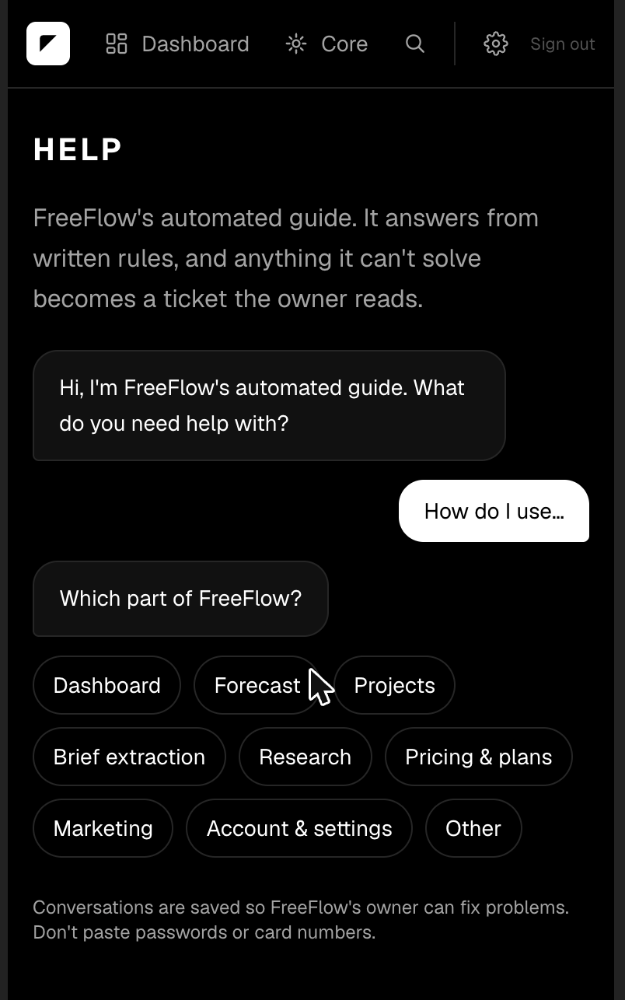
