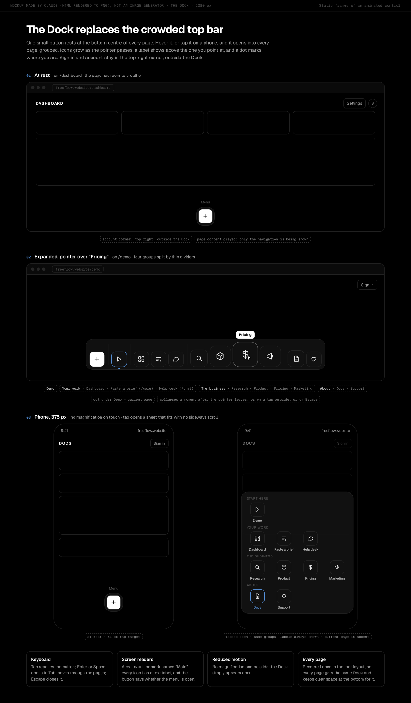
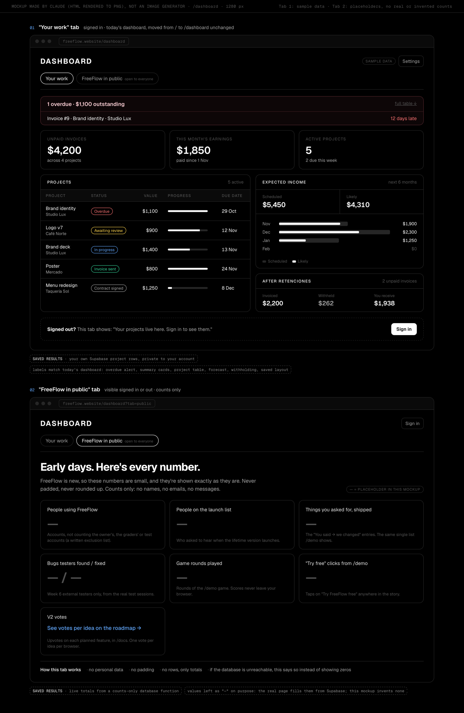
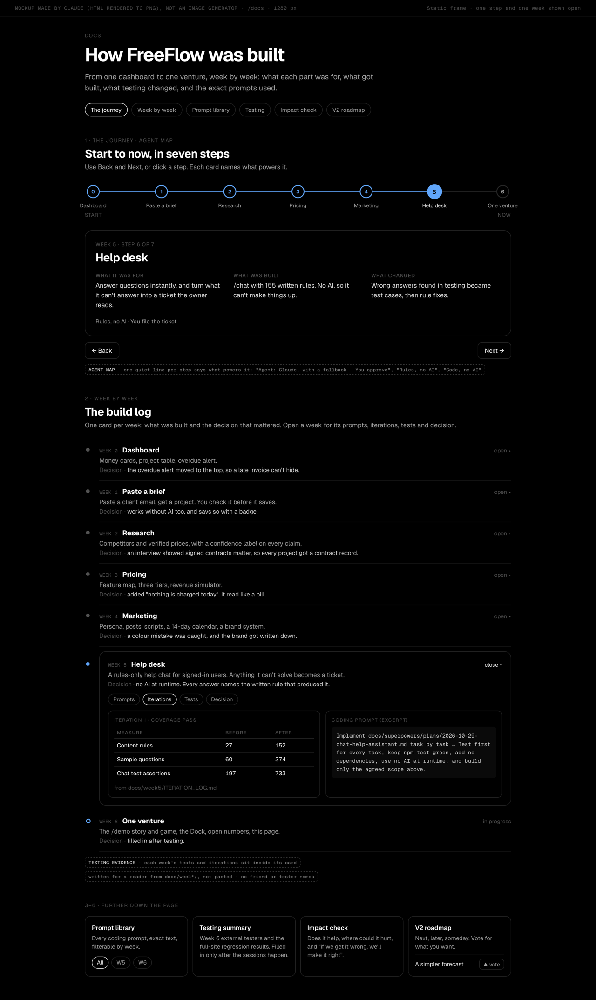

# Week 6: Integrated Agentic Venture + Impact & Viability (Submission Packet)

**Student:** Brayden Credeur · **Course:** Negocios Inteligentes y Comercio Digital, Ibero CDMX · **Project:** FreeFlow · **Date:** November 2026

**Objective:** integrate all modules into a final venture site and prove it works, creates value, and avoids obvious harm.

---

## Required Links

| Item | Link |
|---|---|
| **Live page: /demo** | https://www.freeflow.website/demo |
| **GitHub** | https://github.com/BraydenEC/FreeFlow |
| **Demo video (5 minutes)** | [[⬅️ TO BE ADDED]] |

**Grader logins.** `/demo`, `/docs` and the public tab of `/dashboard` work signed out. To see records on `/dashboard`, sign in at https://www.freeflow.website/login with your demo account.

<!-- logins:start -->
| Email | Password |
|---|---|
| grader1@freeflow.website | [[⬅️ TO BE ADDED]] |
| grader2@freeflow.website | [[⬅️ TO BE ADDED]] |
| grader3@freeflow.website | [[⬅️ TO BE ADDED]] |
<!-- logins:end -->

---

# Build Discipline Packet

Written and committed before any Week 6 code (`a457cd0`, approved by the owner at Gate 1).

## 🧩 Problem: what user problem is this feature solving?

A freelancer keeps their work in their head: which invoice is late, whether the deposit
landed, when the next deadline is, and what they can expect to earn next month. FreeFlow
already answers those questions, but a visitor can't tell. The signed-out landing page is a
list of features, the top bar holds eight links and Week 6 adds more, and the evidence of
how the product was built (seven weeks of research, pricing, tests and decisions) is spread
across files only the grader reads.

The venture problem underneath: FreeFlow has to prove it works, creates value and avoids
obvious harm, and it has to show a visitor that it was built by listening to freelancers,
with intention, rather than claim it. That means one story a stranger can follow, one way
to move around the whole site, and open numbers and sources instead of testimonials.

## 👤 User: who will use it?

| User | Need |
|---|---|
| A freelancer landing on FreeFlow for the first time (designer, photographer, video editor, writer, developer) | Recognise their own late-night worries, see that each one has a real answer, try it for free, or ask to hear about the lifetime version |
| An existing FreeFlow user | Get to their dashboard and every tool from any page, quickly, on a phone |
| The course grader | Find every Module 6 requirement (see the map above) without being told where it is |
| Brayden, the owner | Measure the funnel (try-free clicks, launch-list sign-ups), hear from users, and keep his promise to keep listening and fixing |

## 🎯 Success: what must work by the end of the week?

`/demo` loads for anyone, signed in or out, with no AI key and with the database
unreachable, and a first-time visitor can follow it from 11:47 pm to morning without
instructions, on phone and desktop. Every page carries the Dock. `/dashboard` shows the
signed-in user's own records and a public "FreeFlow in public" tab of counts. `/docs` holds
the journey (agent map), the week-by-week build log, the prompt library, the testing
summary, the impact check and the V2 roadmap with votes. Try-free clicks and launch-list
sign-ups are recorded. Nothing on any new page states a price, names an unbuilt feature on
`/demo`, or invents a testimonial or count. All automated suites pass, five external users
have walked through `/demo` → sign-up → dashboard → docs, at least one bug they found is
fixed and redeployed, and the full-site regression passes.

## 🖼 UX Concept: image mockup + implementation note

The mockups were made by Claude as HTML and rendered to PNG (`swift scripts/snap.swift`),
at the owner's request, from the throwaway prototypes he validated. They are not
image-generator output. They show the target state: no Week 6 code existed when they were
drawn, so every number in them is sample data or a placeholder ("—"). The course's image
prompt is kept for reference in `IMAGE_PROMPT.md`, with a table showing where its four zones
(user input, AI/agent output, saved results, testing evidence) appear. Sources:
`docs/week6/mockup/*.html`.


*Mockup made by Claude (HTML rendered to PNG), not an image generator. `/demo` as one tall
page: chapter 1 mid-sort, a chapter 2 step with the one AI step labelled, the signed story,
the "You said → we changed" proof, the game mid-round, the morning call to action, and the
footer.*



*Mockup made by Claude (HTML rendered to PNG), not an image generator. The Dock at rest,
expanded with magnification over "Pricing", and at 375 px as a tap-open sheet.*



*Mockup made by Claude (HTML rendered to PNG), not an image generator. `/dashboard` with
"Your work" (sample data, today's labels) and "FreeFlow in public" (placeholders only).*



*Mockup made by Claude (HTML rendered to PNG), not an image generator. `/docs`: the journey
stepper (the agent map) on Week 5, then the week-by-week timeline with Week 5 open.*

**Implementation note.** `/demo` is one long scroll in the founder's voice, built on AIDA:
Attention (11:47 pm, sorting the worries), Interest (midnight, the guided walkthrough of
real features), story (1 am, the signed founder story), Desire (the "You said → we changed"
proof), the game as the climax, and Action (8:00 am, try it free or join the launch list).
The worries in chapter 1 are the features in chapter 2 and the upgrades in the game, so the
page is one story rather than a stack of sections. The job picker re-colours the accent and
swaps the examples throughout. Motion is CSS and small hand-written code; under reduced
motion each chapter shows its calm end state. The Dock replaces the top bar's links on every
page. `/dashboard` and `/docs` read the same static content modules as `/demo`, so the same
features, voice and numbers appear everywhere.

## ✂️ Scope Cut: what looked nice but will not be built this week?

From the spec's non-goals:

- Game leaderboard and the "free lifetime access" prize (they wait until scores can be
  protected from cheating)
- A private owner analytics view (the owner already sees emails and chats in Supabase)
- A founder photo, and the before/after photo hover
- Any change to `/pricing` content or to the pricing model beyond the two fixes above
- Any V2 roadmap item (simpler forecast, CFDI, more countries/languages/currencies, studio
  accounts, etc.)
- Paid APIs of any kind

## 🧱 Product Spec: requirements and acceptance criteria

Every criterion below is testable: by an automated suite (**auto**), by reading the source
(**source**), or by a live check at 1280 px and 375 px (**live**).

### Cross-cutting (every new page)

| # | Requirement | Acceptance criterion |
|---|---|---|
| X1 | No price | No new page or component contains a currency amount or "per month" for FreeFlow itself (**source** search). Exceptions: in-game money in the game, and figures inside a view clearly labelled as sample data |
| X2 | No invented proof | Every "You said → we changed" entry has a `source` field naming a real repo file that exists (**auto**); no testimonial, rating, logo or invented count anywhere (**source**) |
| X3 | Friends unnamed | Entries from friends read "a freelancer friend"; no friend or tester name in `lib/`, `components/` or `app/` (**source**) |
| X4 | Reduced motion | Under `prefers-reduced-motion` every animation has a calm static version and nothing depends on motion to be understood (**live**, **source**) |
| X5 | Phone width | At 375 px, 16 px gutters and no horizontal page scroll on `/demo`, `/dashboard`, `/docs` (**live**) |
| X6 | Keyboard and touch | Every interactive element (worries, invoices, upgrades, Dock toggle, steps, votes) is a real `<button>` or link, reachable by Tab and usable by tap (**source**, **live**) |
| X7 | Degrades, never fails | With Supabase unreachable, `/demo`, `/docs` and the public tab render; writes answer 503 `{ saved: false }` and the UI says it couldn't save (**auto**, **live**) |
| X8 | Brand | Colours come from `app/globals.css` tokens; job accents are added there and documented in `docs/week4/BRAND.md` (**source**) |
| X9 | Public contact | Footer, privacy note and the "make it right" promise use `braydenemeryc@gmail.com`; founder signs "Brayden", no photo (**source**) |

### The Dock (navigation)

| # | Requirement | Acceptance criterion |
|---|---|---|
| D1 | On every page | `app/layout.tsx` renders `<Dock />` once; the top bar keeps only the account and Settings corner, with no page links (**source**) |
| D2 | At rest | One round button, bottom centre, labelled "Menu" for screen readers (**live**) |
| D3 | Groups | Opens into Demo · Your work (Dashboard, Paste a brief, Help desk) · The business (Research, Product, Pricing, Marketing) · About (Docs, Support), separated by thin dividers, every link a real route (**auto** on the group data) |
| D4 | Mac feel | With a mouse, icons grow as the pointer passes (pure, tested magnification function), a label shows above the hovered icon, a dot marks the current page; no magnification on touch (**auto**, **live**) |
| D5 | Open and close | Opens on hover, click or tap; closes after a short delay when the pointer leaves, on a tap outside, or on Escape (**live**) |
| D6 | Accessible | `nav` with an accessible name; the toggle exposes `aria-expanded`; every icon has a text label (**source**) |
| D7 | Fits a phone | At 375 px the open Dock fits with no horizontal page scroll (**live**) |

### Routing

| # | Requirement | Acceptance criterion |
|---|---|---|
| R1 | `/demo` public | 200 signed out and signed in (**live**) |
| R2 | `/` signed out | Renders the same funnel component as `/demo` (one component, not a copy); `components/landing/LandingPage.tsx` is removed (**source**, **live**) |
| R3 | `/` signed in | Redirects to `/dashboard` (**live**) |
| R4 | Canonical | `/demo` and `/` both declare `<link rel="canonical">` pointing at `/demo` (**source**, **live**) |
| R5 | No stale "dashboard is /" links | Sign-in success, email verification and every internal link that meant "the dashboard" point at `/dashboard` (**source** search) |
| R6 | Existing pages | `/core`, `/research`, `/product`, `/pricing`, `/marketing`, `/support`, `/chat` and the auth pages still load (**live**) |

### `/dashboard` tabs

| # | Requirement | Acceptance criterion |
|---|---|---|
| B1 | "Your work" | Signed in: today's dashboard (overdue alert, summary cards, project table, forecast, withholding, saved layout) moved from `/`, unchanged in behaviour (**live**) |
| B2 | Signed out | The "Your work" tab invites sign-in; it shows no data (**live**) |
| B3 | "FreeFlow in public" | Visible signed in and out; shows counts for people using FreeFlow, launch list, things you asked for (shipped), bugs testers found / fixed, game rounds played, try-free clicks, and votes per roadmap item or a link to them (**live**) |
| B4 | Counts only | The counts come from one `security definer` function returning aggregates; no select policy exists on any Week 6 table; no row, email or name reaches the browser (**source**, **auto**) |
| B5 | Honest numbers | Small numbers shown as they are; "people using FreeFlow" excludes graders and the owner's `count_exclusions`; unavailable counts say so instead of showing 0 (**source**, **live**) |
| B6 | One list | "Things you asked for, shipped" is the length of the same static list `/demo` shows (**auto**) |

### `/docs` sections

| # | Requirement | Acceptance criterion |
|---|---|---|
| S1 | The journey (agent map) | One line, Start → Now, seven numbered steps (Dashboard 0, Paste a brief 1, Research 2, Pricing 3, Marketing 4, Help desk 5, One venture 6); one card at a time with "What it was for / What was built / What changed" and one line naming what powers it; Back/Next and clickable steps (**live**, **auto** on the data) |
| S2 | Week-by-week timeline | One card per week with what was built and the decision that mattered; each opens to its prompts, iterations, tests and decision (**live**) |
| S3 | Prompt library | Every coding prompt, exact text, filterable by week (**live**, **auto**: each prompt has a week and a source file) |
| S4 | Testing summary | Week 6 external tests and the regression results, filled in only from real sessions; placeholders say so until then (**source**) |
| S5 | Impact check | "Does it help?" (evidence only), the risk table (what could go wrong, who is hurt, what protects), the "make it right" ladder (no cash promise), and "Can it last?" (**live**) |
| S6 | V2 roadmap | Next / Later / Someday items from one static list, each with an upvote (see V1–V4) (**live**) |
| S7 | No friend names | No friend or tester name anywhere on the page (**source**) |

### `/demo` chapters 1–6 (one night, 11:47 pm to morning)

| # | Requirement | Acceptance criterion |
|---|---|---|
| F0 | Shell | A clock advances as you scroll: it comes from scroll progress, 11:47 pm at the top to 8:00 am at the end, so the per-chapter times in the mockup are illustrative; the mood moves from tense (red-tinged edges) through calm to morning light; "Try FreeFlow free" stays reachable throughout (sticky) (**live**) |
| F0b | Job picker | Designer, photographer, video editor, writer, developer; default designer; the choice re-colours the accent in a wave from the click point, swaps worries, project names and game projects, and persists for the visit; text contrast stays accessible (**auto** on job data, **live**) |
| F1 | Chapter 1, 11:47 pm (Attention) | "I'm a freelance [job], and it's all in my head." Worries for that job pop in, the counter and red edges rise; a worry dragged into the FreeFlow panel, or tapped, lands as a calm checked row; after three, "You can't keep up by hand. Nobody can." and "Let FreeFlow handle the rest" appear; pressing it files the rest and the headline becomes "…and now it's all in one place." (**auto** on the sorting logic, **live**) |
| F2 | Chapter 2, midnight (Interest, guided walkthrough) | Each worry resolves into a numbered step naming a built feature, with a one-line benefit and a sample view labelled as sample, grouped Money / Paperwork & tax / Organization; every step maps to a feature marked built in `lib/product/features.ts` (**auto**) |
| F3 | Chapter 3, 1 am (story) | First-person story edited from `docs/week6/FOUNDER_STORY_SOURCE.md` and approved by the owner; ends unsigned; "Brayden" writes itself in handwriting on scroll into view, hover or tap, followed by a short P.S.; no photo (**source**, **live**) |
| F4 | Chapter 4 (Desire, proof) | "You said → we changed" entries from one static list; each cites its source file; the first is the pricing advice, paraphrased and never quoted (`docs/week6/SOURCE_NOTES.md`, entry 1); friends unnamed; labelled placeholders until tester entries exist (**auto**) |
| F5 | Chapter 5 (Climax) | The game (see G1–G8) |
| F6 | Chapter 6, 8:00 am (Action) | Primary "Use FreeFlow free now" → sign-up, recorded as `try_free_click`; secondary launch-list form (see L1–L5); no price (**live**, **source**) |
| F7 | Footer | Contact and feedback `mailto:` to the public address, "If we get it wrong" → the impact section in `/docs`, and the launch-list privacy note (**live**) |

### The game

| # | Requirement | Acceptance criterion |
|---|---|---|
| G1 | Timed | A 60-second round that starts on first interaction (**auto**) |
| G2 | Work | Clicks fill a project's progress; a finished project becomes an invoice; project names follow the picked job (**auto**) |
| G3 | Ageing | Invoices age fresh → yellow → red (overdue); collecting pays the current value; overdue invoices lose value (**auto**) |
| G4 | Upgrades are real features | Paste a brief (more work per click), Overdue alert (warning pulse, slower loss), Contract tracking (overdue invoices keep most of their value), Payment terms (invoices collect themselves on schedule); each links "This is real in FreeFlow" to the feature (**auto**) |
| G5 | Score and end | Score = money collected; end screen "You collected $X. FreeFlow does the chasing for you.", personal best from this browser only, the launch-list and "Try FreeFlow free" actions (**auto**, **live**) |
| G6 | Winnable | A scripted strategy that buys upgrades beats one that doesn't (**auto**) |
| G7 | No leaderboard, no prize | No score is sent to a server; only a `round_played` event is recorded (**source**) |
| G8 | Hidden tab, keyboard, touch | Pauses when the tab is hidden; a long gap between ticks cannot end the round or wipe invoices; playable by keyboard and touch (**auto**, **live**) |

### Launch list

| # | Requirement | Acceptance criterion |
|---|---|---|
| L1 | Consent | The form can't submit without the consent box ticked; the route rejects `consent: false` (**auto**) |
| L2 | Validation | Email is trimmed, lower-cased, valid and at most 254 characters (**auto**) |
| L3 | Repeat sign-up | The same email twice reads as success, never as an error (**auto**) |
| L4 | Privacy note | Says who holds the emails (Brayden, at the public address), what they are for (launch news only) and how to be removed (email him; every launch email has a remove-me link) (**source**) |
| L5 | Protected | Rate-limited; no public read; 503 with a calm message when the database is unreachable (**auto**) |

### Votes (V2 roadmap)

| # | Requirement | Acceptance criterion |
|---|---|---|
| V1 | One vote per item per browser | The browser remembers its vote; a second vote on the same item reads as success, not an error (**auto**) |
| V2 | Valid items only | The route rejects an item id not in the static roadmap list (**auto**) |
| V3 | Counts | Vote counts per item come from the counts function, never from rows (**source**) |
| V4 | Storage blocked | With browser storage unavailable, voting still works or fails quietly; the page never breaks (**source**) |

### `/pricing` fixes

| # | Requirement | Acceptance criterion |
|---|---|---|
| P1 | Framing line | One line on `/pricing`: the tiers are a possible long-term model; the plan for launch is a one-time purchase for full access (**live**) |
| P2 | CFDI marked planned | Where `lib/pricing/tiers.ts` lists CFDI as a tier feature, it reads "planned" (**auto**) |
| P3 | Nothing else changes | The analysis and segment prose are unchanged (**source** diff) |

## 🏗 Architecture: frontend, backend, database, data flow

```
Static content modules (typed TypeScript, in the repo, one source each)
  lib/funnel/*   jobs + accents, worries, walkthrough steps, story, copy
  lib/venture/*  "You said → we changed" changes, roadmap, journey, timeline,
                 prompts, testing (bugs found/fixed)
  lib/game/engine.ts   pure game logic (tick, age, collect, upgrades, score)
        │ read by
        ▼
Pages (Next.js App Router)
  /demo  (also / signed out)  ── DemoFunnel: chapters 1–6, game, sticky CTA
  /dashboard                  ── "Your work" (existing dashboard) + PublicNumbers
  /docs                       ── JourneyStepper, WeekTimeline, PromptLibrary,
                                 TestingSummary, ImpactCheck, Roadmap
  every page                  ── <Dock /> in app/layout.tsx
        │ anonymous writes (rate-limited, zod-validated)
        ▼
  POST /api/funnel         { event, job?, visitId }    → funnel_events
  POST /api/launch-list    { email, consent, source }  → launch_list
  POST /api/roadmap/vote   { itemId, voterKey }        → roadmap_votes
        │ insert-only RLS, no select policy on any of them
        ▼
Supabase (Postgres)
  funnel_events · launch_list · roadmap_votes · count_exclusions (owner-filled)
  venture_counts()  security definer → JSON of totals only
        │ read via supabase.rpc("venture_counts")
        ▼
  "FreeFlow in public" tab (/dashboard)  and  vote counts (/docs roadmap)

Signed-in records (unchanged): /dashboard "Your work" → existing projects table (RLS per account)
Routing: proxy.ts (Next.js 16) · / signed in → /dashboard · / signed out → funnel
No database or AI key → /demo still works fully; writes answer 503 { saved: false }
```

## 🧰 Tech Stack: tools, libraries, services, and why

| Tool | Why |
|---|---|
| Next.js 16.3 App Router, React 19 | The existing app; `proxy.ts` handles route protection |
| Tailwind v4 with `app/globals.css` tokens | Existing brand system; job accents added there once |
| `next/font/google` (Geist, Caveat) | Geist is the brand face; Caveat draws the "Brayden" signature. Free, self-hosted at build |
| Supabase (Postgres, RLS, `@supabase/ssr`) | Existing auth and database; three insert-only tables and one aggregate function |
| zod 4 | Already installed; validates every write route |
| `lib/ratelimit.ts` | Existing sliding-window limiter, no dependency |
| CSS and small hand-written TypeScript for motion | No animation library: smaller, and easy to give a reduced-motion version |
| Node strip-types test runner (`scripts/test-*.ts`) | The project's existing test setup; new suites for venture content, funnel content and the game |
| Vercel + GitHub | Existing deploys; free tier |

No paid API is required. Paste a brief keeps its existing Claude call with a labelled
fallback; nothing new uses AI at runtime.

## ⚙️ DevOps: GitHub, Vercel, Supabase, env variables, deployment plan

Work on branch `week6`. GitHub `main` deploys to Vercel production
(https://www.freeflow.website); each push to the branch gets a preview. Environment
variables are unchanged: no new keys. The migration `supabase/week6_venture.sql` is run by
the owner in the Supabase SQL Editor; it is idempotent, never drops a table and ends with a
verify block. Until it is run, the write routes answer 503 and the public counts show as
unavailable, which is the designed degraded state. Each push is gated on exit codes:
`npm test`, `npm run lint`, `npm run build`, then `npx tsc --noEmit`. At least 5 commits and
2 Vercel deployments: the first after the full-site regression, the second after fixing a
bug the external testers found.

## 🧪 Test Plan: how will you verify it works?

- **Automated (`npm test`, `npm run test:chat`):** venture content integrity (every change
  cites an existing file, roadmap ids unique, journey has seven steps, prompts have weeks);
  funnel content per job (every walkthrough step is a built feature, five jobs, accents from
  the brand); game engine (timer, ageing, collection, each upgrade's effect, scoring,
  winnability, long-tick clamp); schemas (email normalisation, consent, unknown item, unknown
  event); route source checks (rate limit before parsing, 503 with no client, `23505` as
  success, never `.select(`); UI source checks (real buttons, storage wrapped in
  try/catch, canonical link, no price strings, no friend names).
- **Live checks:** every page signed out, signed in, and at 375 px, including the Dock on
  each; `/demo` with the database unreachable; `/` signed in and out; a real launch-list
  sign-up and a repeat; a vote and a repeat; the public tab with no personal data.
- **Full-site regression:** all automated suites plus the live checks above, recorded in
  `docs/week6/TEST_EVIDENCE.md`.
- **5 external users** (recruited by the owner): each walks `/demo` → sign-up → dashboard →
  docs. Only what really happened is recorded, in `docs/week6/EXTERNAL_TESTS.md`, with no
  names. At least one bug they find is fixed, tested and redeployed, and logged in
  `docs/week6/ITERATION_LOG.md`.

## 🤖 Coding Agent Prompt: exact prompt to Claude Code

> Implement `docs/superpowers/plans/2026-11-09-week6-integrated-venture.md` task by task
> against the spec `docs/superpowers/specs/2026-11-09-week6-integrated-venture-design.md`,
> and build only the agreed scope in `docs/week6/PLAN.md`. Before writing route, layout,
> metadata or font code, read the relevant guide in `node_modules/next/dist/docs/`: this is
> Next.js 16 and route protection lives in `proxy.ts`. Test first for every pure module
> (content, funnel, game, schemas) and keep `npm test`, `npm run lint`, `npm run build` and
> `npx tsc --noEmit` green. Match the feel of the validated prototypes in
> `.superpowers/brainstorm/*/content/` and use `app/globals.css` as the only source of
> colour. Never state a price on a new page, never name an unbuilt feature on `/demo`, never
> invent a testimonial, count, rating, logo or "You said → we changed" entry, and keep
> friends and testers unnamed. Every animation needs a calm reduced-motion version, every
> interaction must work by keyboard and touch at 375 px, and `/demo` must work with no AI
> key and no database. Add no paid service and no runtime dependency without a one-line
> reason. Never handle the Supabase secret key: the owner runs `supabase/week6_venture.sql`.
> The course coding tasks map onto the plan as: integrate all pages (Tasks 6 and 9: the
> Dock and `/` routing), create /dashboard (Task 7), create /demo (Tasks 9–12), create agent
> map (Task 8, the journey stepper), create testing summary (Tasks 8 and 15), create
> version 2 roadmap (Tasks 2, 5 and 8).

---

# Weekly Submission Packet: Evidence

| Item | Required | Delivered |
|---|---|---|
| 🌐 Live URL | Working deployed page | ✅ https://www.freeflow.website/demo (HTTP 200) |
| 🧩 Build Discipline Packet | Complete before coding | ✅ Above, committed before any Week 6 code (`a457cd0`) |
| 🖼 UX Image / Mockup | Image or wireframe | ✅ Four mockups + implementation note (above) |
| 🧱 Product Spec | Requirements + acceptance criteria | ✅ Above |
| 🏗 Architecture Sketch | Data flow and components | ✅ Above |
| 🧑‍💻 GitHub Commits | Minimum 5 | ✅ **26** for Week 6 (below) |
| 🚀 Vercel Deployments | Minimum 2 | ✅ 2 production deploys: `9cdc45d`, `3dc3b02` [[⬅️ add deploy after the tester fix]] |
| 🗄 Supabase Evidence | Table/data evidence | ✅ Migration verify output and live counts (below) |
| 🤖 Prompt Log | Minimum 5 coding prompts | ✅ **28** (below) |
| 🧪 Test Evidence | 5 external users + full-site regression | ✅ Regression (below). [[⬅️ 5 external users: TO BE ADDED]] |
| 🔁 Iteration Log | What changed after testing | ✅ Review fixes (below). [[⬅️ tester-driven fix: TO BE ADDED]] |
| 🎥 Demo Video | 5 minutes | [[⬅️ TO BE ADDED]] |
| 🧠 Human Decision Note | 150–250 words | [[⬅️ TO BE ADDED, in your own words]] |

## Week 6 commits

| Commit | Date | What |
|---|---|---|
| `0019133` | Nov 9 | Week 6: approved design for the integrated venture (demo funnel, Dock, dashboard, docs) |
| `497e7ab` | Nov 9 | Week 6: implementation plan |
| `a457cd0` | Nov 10 | Week 6 Gate 1: build discipline packet, source notes and mockups |
| `cb494a9` | Nov 10 | Week 6 Gate 1: pricing source from the real chat, PLAN fixes, 1x mockups |
| `99fac36` | Nov 10 | Week 5: replace tester first names with Tester 1-3 |
| `4179870` | Nov 10 | Week 6: venture content modules (changes, roadmap, journey, timeline, prompts) |
| `c93335f` | Nov 10 | Week 6: per-job funnel content, walkthrough map and job accent tokens |
| `c92c9e9` | Nov 10 | Week 6: pure game engine with tests |
| `54a3406` | Nov 10 | Week 6: venture tables, aggregate counts function and anonymous write routes |
| `ffb515b` | Nov 10 | Week 6: Mac-style Dock replaces the top bar's page links |
| `cca4905` | Nov 10 | Week 6: /dashboard with your work and FreeFlow in public |
| `52d4461` | Nov 10 | Week 6: /docs with journey, timeline, prompts, testing, impact and roadmap |
| `514566c` | Nov 10 | Week 6: /demo shell with job picker, story clock and mood; / serves the same funnel |
| `d08df00` | Nov 10 | Week 6: chapter 1, sort the night's worries |
| `2630dd7` | Nov 10 | Week 6: chapters 2-4, walkthrough, signed founder story, you said we changed |
| `4d7a8fe` | Nov 10 | Week 6: chapter 5 game, chapter 6 morning, launch list and footer |
| `9244b50` | Nov 10 | Week 6: /pricing says the tiers are long-term and CFDI is planned |
| `eee0ea6` | Nov 10 | Week 6: lint fix in funnel tests (prefer-const) |
| `5e88951` | Nov 10 | Week 6: final review fixes (Dock misclick, drag flicker, phone scroll, help desk, SQL checks) |
| `91cb087` | Nov 10 | Week 6: fixes re-graded from the review's minors (stale drag click, phone clipping, double round count) |
| `9cdc45d` | Nov 10 | Week 6: prompt log (28 prompts, quoted from the session transcripts) |
| `876cac4` | Nov 10 | Week 6: test evidence for regression, migration and deploy #1 |
| `50fb593` | Nov 10 | Week 6: test evidence names the right commit |
| `b202d84` | Nov 10 | Week 6: founder story says FreeFlow was built by choice, not for a class |
| `3dc3b02` | Nov 10 | Week 6: founder story wording approved by the owner |
| `9ce4805` | Nov 10 | Week 6: signed-in and 375 px live checks pass |

## Vercel deployments

| # | Commit | Date | What went live |
|---|---|---|---|
| 1 | `9cdc45d` | Nov 10 | The integrated venture: `/demo`, the Dock, `/dashboard`, `/docs`, `/pricing` fixes |
| 2 | `3dc3b02` | Nov 10 | Founder story wording approved by the owner; test evidence |
| 3 | [[⬅️ TO BE ADDED]] | | Fix from the external tests |

## Supabase evidence

`supabase/week6_venture.sql` adds `funnel_events`, `launch_list`, `roadmap_votes` and `count_exclusions`, insert-only for the public API roles, plus `venture_counts()`, which returns aggregate counts only. Verify output after running it in the SQL Editor:

| rls_on | insert_policies | other_policies | anon_select_grants | counts |
|---|---|---|---|---|
| 4 | 3 | 0 | 0 | `{"users":2,"launchList":0,"tryFreeClicks":0,"roundsPlayed":0,"votes":{}}` |

Live writes on production: a roadmap vote saved, the same vote again read as "already voted", an unknown item was refused (400), a "Try free" click saved, and both counts rose on the live `/dashboard` and `/docs`.

---

# Prompt Log

| # | Date | Prompt | Result |
|---|---|---|---|
| 1 | Nov 9 | "read all documents in this folder ('…/Module 6') then create a full outline using /brainstorm skill before beginning the build" | All four Module 6 PDFs read; brainstorming began before any code |
| 2 | Nov 9 | "That the webaite genuinely believes in listening to its users and cares about user efficiency and features that help customers. That the website had a lot of thought and intentionality" | The venture's message: built by listening. It became "You said, we changed" and the public roadmap |
| 3 | Nov 9 | "The payment design for the website came from a user and a friend of mine. It suggested that the models starts off being free, getting users on and over time once a actual customer base is built then I can add a one time subscription model because it makes it a lot easier than a repeat purchase" | Free now, one-time purchase later. Recorded with the friend's own chat in `SOURCE_NOTES.md` |
| 4 | Nov 9 | "yes that is potentially how I would price the webaite, if not I would just stick with the one time purchase, because its a tools based app it makes more sense from a pricing model in my opinion to be a one time purchase for full acccess" | No price on any new page; `/pricing` keeps its tiers, framed as a possible long-term model |
| 5 | Nov 9 | "Please outline only what I need for ONLY module 6, nothing from preious models, what does module 6 ask for?" | The requirement map in `PLAN.md` |
| 6 | Nov 9 | "I want you to follow marketing research for a page funnel, this is what I want /demo to be, I want it to be a landing page and a marketing funnel guided at grabbing users attention and using the complete marketing funnel to get them to use the product and buy it once I make it paid. use this handoff for reference, add any iterations if needed." *(pasted funnel brief)* | `/demo` became the landing page and an AIDA funnel |
| 7 | Nov 9 | "Would you recommend if the demo pages just merge into one? I would rather it build into one landing page instead having two seperate one I think it makes more sense, what do you think?" | One funnel: `/` signed out shows the same component as `/demo`; the old landing page was retired |
| 8 | Nov 9 | "If someone who is suigned in, they should be able to see the demo page if they click on it, because it doesnt necissarily mean that they have purchased or used the product yet" | `/demo` is public and works signed in |
| 9 | Nov 9 | "I was thinking that it was interactive, … I would like the page to be flowy, dynamic and creative, something that isnt "ordinary" something that is showy but still minimal, please ask questions until 100% sure" | Interactive story direction; reference sites reviewed next |
| 10 | Nov 9 | "mouse or finger, I dont know exactly what I want the game to be yet, I was initially thinking something sort of like cookie clicker but instead of cookies its related to freelance" | The 60-second freelance clicker: work, invoice, collect, upgrade |
| 11 | Nov 9 | "I dont know what to go for, I like the Playfolly idea because it plays more along the customized for the user idea but I also like the chaos to flow, showing a real example of the issue that users have thats also interactive" | Both: the "I'm a freelance…" job picker and the worry-sorting night |
| 12 | Nov 9 | "I would like to try a different iteration of both parts, they look okay but I feel as though something is missing, It does not feel interactive or emotive enough" | Hero v2: stress builds, you sort it, relief |
| 13 | Nov 9 | "… fixing the top features bar, I think it is too crowded and would like something like an animated toolbar feature, when you hover or click it, it expands with all of the different feature pages, like the toolbar on a laptop" | The Dock |
| 14 | Nov 9 | "… I want it to build up to the finally instead of being thrown into one section of the page. I want everything to mesh, to flow and tell a story" | One night, 11:47 pm to 8:00 am, in six chapters with the game as the climax |
| 15 | Nov 9 | "What the different sections / modules were for, what was built or done, what changed. I want someone to understand the journey that the website took" | The `/docs` journey stepper (the agent map) |
| 16 | Nov 9 | "The mockup feels like a lot and feels overwhelming, too much going on visuall for the user to be able to spot a certain begin and end out" → "perfect" | One line, Start to Now, one card at a time |
| 17 | Nov 9 | "The outcome I would worry about the most is how it effected the user and its client, what the real damage was and how I can better and fix it, but also compensate the user. …" | The impact check's harm table and "make it right" ladder |
| 18 | Nov 9 | "Im not sure yet, ca you do research on what small startups like this have done in order to compensate or fix an issue regarding its user issue? …" | Ladder ends at free lifetime access; no cash promise |
| 19 | Nov 9 | "Something I would add or change would be an easier to use forecaster or income predictor, …" + "More legal sections that are for more users than just in mexico city, usa europe etc.more languages and currency list." | The V2 roadmap |
| 20 | Nov 9 | "I can get 5 testers dont worry about that" | External testing left to the owner; nothing invented |
| 21 | Nov 10 | "There should be no leaderboard yet but for now just the game, the leaderboard can be figured out later once we figure out how to proof the cheating." | No leaderboard, no score sent anywhere; leaderboard is a "Later" roadmap item |
| 22 | Nov 10 | "I dont want my photo to be up there now but my name yes, … can you help me brainstorm a cool hover effect?" → "I like C a lot, it feels personal and true to me" | The story is signed "Brayden" in handwriting that writes itself; no photo |
| 23 | Nov 10 | "I want the friend to stay unnamed. create a mockup yourself please. This is most of the founder story …" | Founder story saved verbatim; mockups made by Claude as HTML rendered to PNG |
| 24 | Nov 10 | "I did videography and video editing, something that for me was very time consuming …" | The story opens with it; video editor became a job in the picker |
| 25 | Nov 10 | "Use subagent driven, before continuing use /handoff" | Plan executed task by task; Gate 1 packet built and reviewed first |
| 26 | Nov 10 | "He had told me to do the facebook strat, I can paste the conversation here. … I would rather keep the repo light to reduce load times etc... Do what you think is best" | The friend's real chat transcribed into `SOURCE_NOTES.md`; mockups shrunk to 1x |
| 27 | Nov 10 | "continue to work, use native for now as its quicker and we can do a full sweep for the end to ensure stability and speed" | Tasks 2–13 built test-first inline; a fresh whole-branch review at the end found 4 important issues, all fixed |
| 28 | Nov 10 | "continue" | Testing and submission documents prepared while the deploy waits on the owner's steps |

---

# Test Evidence

## 5 external users

| Tester | Date | What they did | What they said | What changed because of it |
|---|---|---|---|---|
| Tester 1 | [[⬅️]] | [[⬅️]] | [[⬅️]] | [[⬅️]] |
| Tester 2 | [[⬅️]] | [[⬅️]] | [[⬅️]] | [[⬅️]] |
| Tester 3 | [[⬅️]] | [[⬅️]] | [[⬅️]] | [[⬅️]] |
| Tester 4 | [[⬅️]] | [[⬅️]] | [[⬅️]] | [[⬅️]] |
| Tester 5 | [[⬅️]] | [[⬅️]] | [[⬅️]] | [[⬅️]] |

## Full-site regression test

| Check | Result |
|---|---|
| `npm test` | 21 suites, 1,761 passed, 0 failed |
| `npm run lint`, `npm run build`, `npx tsc --noEmit` | all exit 0 |
| Every page live, signed out | 12 pages HTTP 200; `/core` redirects to sign-up |
| Signed in | `/` and `/login` go to `/dashboard`; "Your work" shows the records from Supabase; the public tab is beside it |
| Every page at 375 px, signed in | no sideways scrolling on any of 11 pages; the Dock on each |
| Live writes | vote, duplicate vote, refused vote, "Try free" click, counts rise |

---

# Iteration Log: What Changed After Testing

## 1. A fresh code review of the whole site before release

Four problems a visitor would hit, each fixed with a test that failed first:

- Hovering opened the Dock and moved its button, so a click aimed at the button opened a page instead. Page icons now wait a moment before taking a click.
- A dragged worry stuttered because its shake animation fought the drag. Dragging now stops the shake.
- On phones, the worry panel blocked scrolling the page. Only the worries block it now.
- Three help-desk answers still described the old top bar and said FreeFlow sends no other email. They now match the site.

Three smaller findings were re-graded by their effect and fixed too: the first tap after a drag was ignored, a game round could be counted twice in the public numbers, and long worries were cut off on phones.

## 2. The owner's own review

- The founder story said it was built "for a class". It now says it was built by choice.

## 3. From the external tests

[[⬅️ TO BE ADDED: the bug a tester found, the failing test, the fix, the redeploy]]

---

# Human Decision Note

[[⬅️ TO BE ADDED: 150–250 words in your own words: decisions, rejections, corrections and tradeoffs]]
